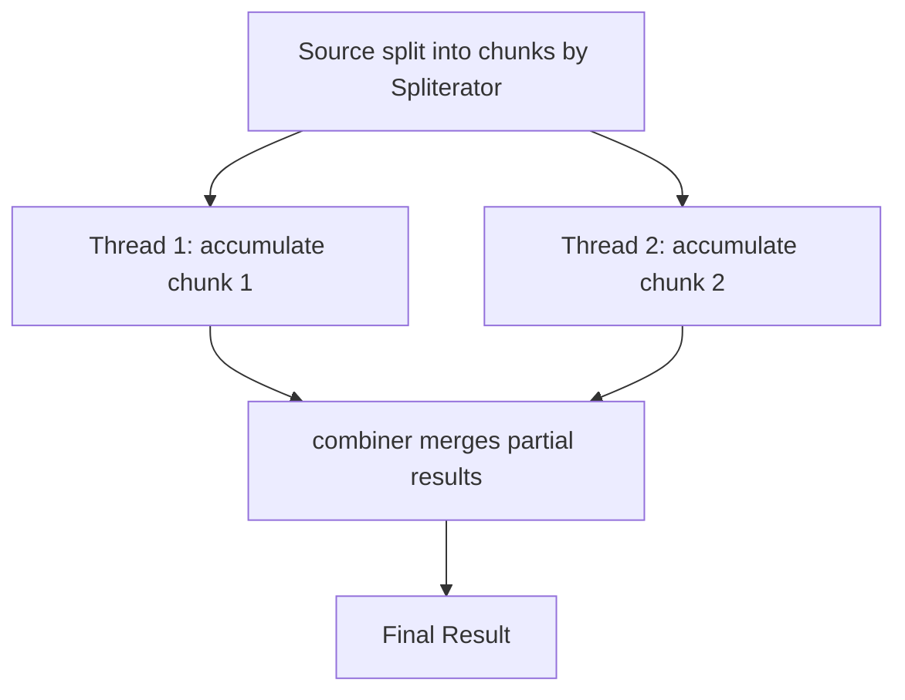

# 9. Reduce

⬅ Back to [[00-Home]] | Prev: [[08-Collectors]] | Next: [[10-FlatMap]]

## The Three Overloads

```java
Optional<T> reduce(BinaryOperator<T> accumulator);
T reduce(T identity, BinaryOperator<T> accumulator);
<U> U reduce(U identity, BiFunction<U,T,U> accumulator, BinaryOperator<U> combiner);
```

### 1. No identity → `Optional<T>`
```java
Optional<Integer> sum = nums.stream().reduce((a, b) -> a + b);
sum.ifPresent(System.out::println);
```
Returns empty `Optional` if stream is empty (no identity to fall back to).

### 2. With identity → `T`
```java
int sum = nums.stream().reduce(0, (a, b) -> a + b);
int sum2 = nums.stream().reduce(0, Integer::sum);
```
Identity acts as (a) the result for an empty stream, and (b) the starting accumulator value.

### 3. With identity, accumulator, and combiner → `U` (type change / parallel-safe)
```java
int totalLength = words.stream()
        .reduce(0,
                (partialResult, word) -> partialResult + word.length(),  // accumulator: U + T -> U
                (r1, r2) -> r1 + r2);                                     // combiner: U + U -> U (parallel merge)
```
Needed when reducing to a **different type** than the stream's element type (`T` → `U`), especially so **parallel streams** know how to merge partial per-thread results.

## Why the Combiner Matters (Parallel Correctness)


In a **sequential** stream, the combiner is never invoked — but you must still supply a *correct* one, because switching `.stream()` → `.parallelStream()` should never change semantics.

## Classic Interview Trap: `reduce` with Type Change on Parallel Streams

```java
// WRONG on parallel streams: mutates a shared, non-thread-safe List!
List<Integer> result = nums.parallelStream()
        .reduce(new ArrayList<Integer>(),
                (list, n) -> { list.add(n); return list; },   // BUG: mutates + returns same list across threads
                (l1, l2) -> { l1.addAll(l2); return l1; });
```
This is unsafe and can lose elements or throw `ConcurrentModificationException`. **Use `collect()` for mutable reduction, not `reduce()`.** This is exactly *why* `collect()` exists — see [[08-Collectors]] and [[16-Stream-vs-Collection]].

## `reduce` vs `Collectors.reducing`

```java
// Same result, but reducing() is a Collector, usable as a groupingBy downstream:
Map<String, Optional<Employee>> highestPaidPerDept = employees.stream()
        .collect(Collectors.groupingBy(Employee::getDepartment,
                Collectors.reducing((e1, e2) -> e1.getSalary() > e2.getSalary() ? e1 : e2)));
```

## Real Examples

```java
// Product of all numbers
int product = nums.stream().reduce(1, (a, b) -> a * b);

// Longest string
Optional<String> longest = words.stream().reduce((a, b) -> a.length() >= b.length() ? a : b);

// Concatenate with StringBuilder (type-changing reduce)
String joined = words.stream().reduce("", (acc, w) -> acc + w);   // OK but O(n^2)-ish; prefer Collectors.joining
```
⚠️ Avoid string concatenation via `reduce`/`+` in a loop-like fashion — `Collectors.joining()` is both clearer and far more efficient (uses `StringBuilder` internally, single pass).

## When to Use `reduce` vs `collect`

| Use `reduce` | Use `collect` |
|---|---|
| Combining immutable values into a single immutable value (sum, product, max) | Building a **mutable** result container (List, Map, Set, StringBuilder) |
| Accumulator/combiner have no side effects | You need a mutable accumulator for efficiency |
| Result type is the same or a simple wrapper | Result is a standard collection or complex structure |

## Interview Soundbite

> "`reduce` combines stream elements into a single result using an associative accumulator function. The 3-arg overload's combiner exists purely for parallel correctness — the accumulator must be associative and side-effect-free, and you should never use `reduce` to build a mutable collection; that's what `collect` is for."

Next: [[10-FlatMap]]
