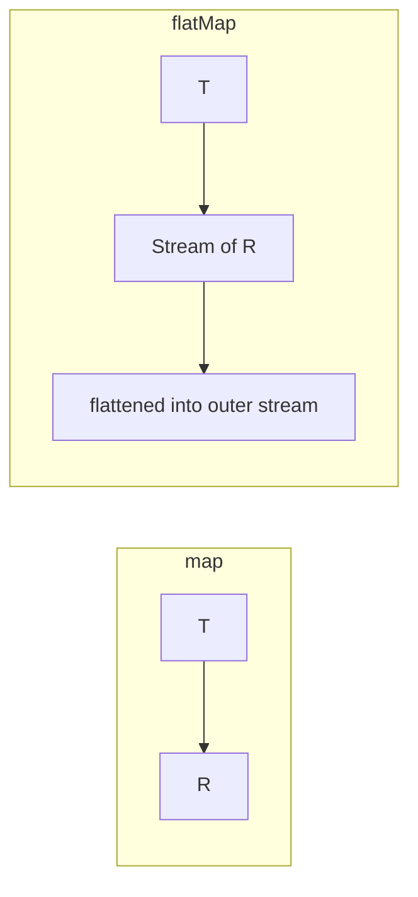

# 10. FlatMap

⬅ Back to [[00-Home]] | Prev: [[09-Reduce]] | Next: [[11-Parallel-Streams]]

## The Core Idea: "Map, Then Flatten"

`map` is 1-to-1. `flatMap` is **1-to-many, then flattened into a single stream.**

```java
<R> Stream<R> flatMap(Function<? super T, ? extends Stream<? extends R>> mapper);
```



## Classic Example: List of Lists → Single List

```java
List<List<Integer>> nested = List.of(List.of(1,2,3), List.of(4,5), List.of(6));

List<Integer> flat = nested.stream()
        .flatMap(List::stream)
        .collect(Collectors.toList());
// [1, 2, 3, 4, 5, 6]
```

Without `flatMap`, `map(List::stream)` would give you a `Stream<Stream<Integer>>` — a stream of streams, which is rarely what you want.

## Example: Splitting Sentences into Words

```java
List<String> sentences = List.of("Hello world", "Java Streams rock");

List<String> words = sentences.stream()
        .flatMap(s -> Arrays.stream(s.split(" ")))
        .collect(Collectors.toList());
// [Hello, world, Java, Streams, rock]
```

## Example: Flattening `Optional` (Java 9+ has `Optional.stream()`)

```java
List<Optional<String>> maybeValues = List.of(Optional.of("A"), Optional.empty(), Optional.of("B"));

List<String> present = maybeValues.stream()
        .flatMap(Optional::stream)
        .collect(Collectors.toList());
// [A, B]
```

## Example: Employees → All Their Projects

```java
record Employee(String name, List<String> projects) {}

List<String> allProjects = employees.stream()
        .flatMap(e -> e.projects().stream())
        .distinct()
        .toList();
```

## `flatMap` vs `map` — Side by Side

```java
Stream<List<Integer>> s1 = nested.stream().map(List::stream) ; // COMPILE ERROR actually — map returns Stream<Stream<Integer>>
Stream<Stream<Integer>> s2 = nested.stream().map(List::stream); // stream of streams — awkward
Stream<Integer> s3 = nested.stream().flatMap(List::stream);      // flattened — what you usually want
```

## `flatMapToInt` / `flatMapToLong` / `flatMapToDouble`

```java
int totalChars = sentences.stream()
        .flatMapToInt(String::chars) // IntStream of char codes
        .sum();
```

## Performance Note

`flatMap` can be more expensive than `map` because it must create and then merge multiple inner streams. For large nested structures, be mindful of:
- Creating many small streams (JIT overhead).
- Losing size information (`SIZED` flag) — `count()` after a `flatMap` **cannot** short-circuit, since the resulting size isn't known upfront.

## `mapMulti` (Java 16+) — A Non-Stream Alternative

```java
Stream<Integer> flat = nested.stream()
        .<Integer>mapMulti((list, consumer) -> list.forEach(consumer));
```
`mapMulti` avoids creating intermediate `Stream` objects for each element, which can be faster than `flatMap` when the "many" side is small (few elements per input) — useful in hot-path/performance-sensitive code. See [[15-Performance]].

## Interview Soundbite

> "`flatMap` transforms each element into a stream of zero-or-more elements and flattens all those streams into one continuous stream — essential whenever you're dealing with nested collections, one-to-many relationships, or need to 'unwrap' structures like `Optional` or `List<List<T>>`."

Next: [[11-Parallel-Streams]]
