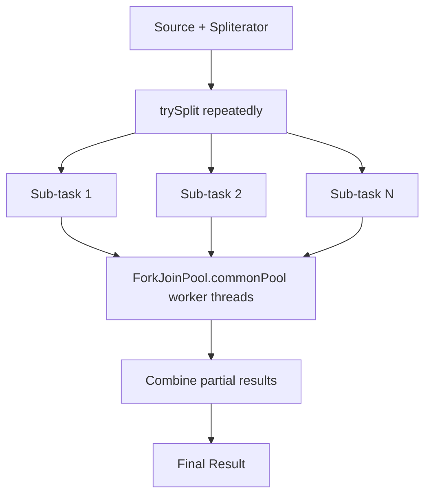

# 11. Parallel Streams

⬅ Back to [[00-Home]] | Prev: [[10-FlatMap]] | Next: [[12-Spliterator]]

## Creating a Parallel Stream

```java
list.parallelStream();          // from Collection
list.stream().parallel();       // convert existing stream
stream.sequential();            // convert back
```
`isParallel()` reflects the state; the **last call wins** if you mix `.parallel()`/`.sequential()` in a chain (rare but a known gotcha).

## Under the Hood: Fork/Join Framework



- Parallel streams use `ForkJoinPool.commonPool()` **by default** — a shared pool sized to `Runtime.getRuntime().availableProcessors() - 1` worker threads (plus the calling thread).
- The stream's `Spliterator` is recursively split (`trySplit()`) until chunks are small enough (heuristically decided by the framework), then processed on worker threads, then merged via the `combiner` (for `reduce`/`collect`) or by concatenating `Node`s.

## When Parallel Streams Help

✅ Good candidates:
- **Large** data sets (thousands+ elements — the overhead of splitting/merging must be smaller than the gains).
- **CPU-bound**, computationally expensive per-element work.
- Data source with an **efficient, balanced `Spliterator`** — arrays, `ArrayList`, `IntStream.range` split extremely well. `LinkedList`, `Stream.iterate` split poorly or not at all.
- Operations that are **stateless and associative** (`sum`, `max`, `filter`+`map`+`collect`).

❌ Bad candidates:
- **Small** collections (overhead > benefit).
- **I/O-bound** operations (parallel streams don't help — threads block on I/O, and the common pool is meant for CPU work; blocking it can starve *other* parts of the app using the common pool, e.g. `CompletableFuture`).
- Sources with poor splitting characteristics (`LinkedList`, `Stream.iterate`, `BufferedReader.lines()` in some cases).
- Operations needing strict **ordering** (`forEachOrdered`, `limit`/`skip` on ordered streams) — these can serialize work and erase the parallel benefit.
- Anything mutating **shared, non-thread-safe state** (see below).

## The #1 Parallel Streams Bug: Unsafe Shared Mutable State

```java
// BUG: ArrayList is not thread-safe!
List<Integer> results = new ArrayList<>();
nums.parallelStream().forEach(results::add);   // race condition, may lose elements or throw

// FIX: let collect() handle thread-safety internally
List<Integer> results = nums.parallelStream().collect(Collectors.toList());
```
See [[18-Common-Bugs]] for more variants of this trap.

## Spliterator Quality Matters (see [[12-Spliterator]])

| Source | Splits well? |
|---|---|
| `ArrayList`, arrays, `IntStream.range` | ✅ Excellent (random access, balanced) |
| `HashSet`, `TreeSet` | ✅ Good |
| `LinkedList` | ⚠️ Poor (must walk links to find midpoint) |
| `Stream.iterate` (unbounded) | ❌ Cannot split without a known size |
| `Files.lines()` | ⚠️ Depends on JDK/impl, generally moderate |

## Common Pool Pitfall: Blocking / Long Tasks Starve the Whole App

Because `ForkJoinPool.commonPool()` is shared **application-wide**, a long-running or blocking parallel stream can starve other unrelated parallel streams or `CompletableFuture.supplyAsync` tasks elsewhere in the same JVM.

**Fix:** run inside a custom `ForkJoinPool`:
```java
ForkJoinPool customPool = new ForkJoinPool(4);
try {
    customPool.submit(() ->
        nums.parallelStream().map(this::expensiveOp).collect(Collectors.toList())
    ).get();
} finally {
    customPool.shutdown();
}
```

## Ordering Costs

```java
list.parallelStream().findFirst();  // must preserve order -> more coordination
list.parallelStream().findAny();    // no ordering constraint -> faster
list.parallelStream().unordered().limit(10);  // relaxes ordering, can be much faster than ordered limit
```

## Measuring Before Trusting

**Never assume parallel is faster — measure with realistic data sizes using JMH.** Overhead of thread coordination, splitting, and merging often outweighs benefits for anything under ~10,000 elements or cheap-per-element work. See [[15-Performance]].

## Interview Soundbite

> "Parallel streams use the common `ForkJoinPool`, splitting the source via its `Spliterator` and merging results with the collector's combiner or reduce's combiner. They pay off only for large, CPU-bound, easily-splittable, stateless workloads — and they are dangerous with non-thread-safe shared mutable state, which is why `collect()` (not manual `forEach` + external list) is the correct pattern."

Next: [[12-Spliterator]]
