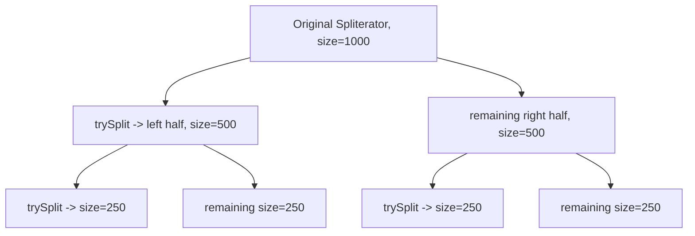

# 12. Spliterator

⬅ Back to [[00-Home]] | Prev: [[11-Parallel-Streams]] | Next: [[13-Primitive-Streams]]

## What Is a Spliterator?

`Spliterator<T>` ("**Split**-able **Iterator**") is the engine that powers every Stream — both sequential and parallel traversal. It's `java.util`'s answer to: "how do I traverse a source **and optionally split it in half** for parallel processing?"

```java
public interface Spliterator<T> {
    boolean tryAdvance(Consumer<? super T> action);   // process one element, return false if none left
    Spliterator<T> trySplit();                        // split off a prefix, return it (or null if can't split)
    long estimateSize();                               // estimated remaining elements
    int characteristics();                              // bit-flags: ORDERED, DISTINCT, SORTED, SIZED, NONNULL, IMMUTABLE, CONCURRENT, SUBSIZED
    default void forEachRemaining(Consumer<? super T> action) { ... } // default: loops tryAdvance
}
```

## Characteristics Bit-Flags

| Flag         | Meaning                                                     |
| ------------ | ----------------------------------------------------------- |
| `ORDERED`    | Encounter order matters/is defined                          |
| `DISTINCT`   | No duplicate elements (source-verified)                     |
| `SORTED`     | Elements arrive in sorted order                             |
| `SIZED`      | `estimateSize()` is exact                                   |
| `SUBSIZED`   | After a split, both parts report exact sizes                |
| `NONNULL`    | Guaranteed no `null` elements                               |
| `IMMUTABLE`  | Source cannot be structurally modified                      |
| `CONCURRENT` | Source can be safely modified concurrently while traversing |

These flags feed directly into the pipeline optimizations discussed in [[03-Internal-Architecture]] (e.g., skipping a redundant `.sorted()` if `SORTED` is already set).

## How `trySplit()` Enables Parallelism


The Fork/Join framework calls `trySplit()` recursively until chunks are small enough (based on a target size heuristic), then assigns each leaf chunk to a worker thread.

## Getting a Spliterator

```java
Spliterator<String> sp = list.spliterator();
Spliterator<Integer> intSp = IntStream.range(0, 100).spliterator();
```

## Writing a Custom Spliterator

Useful when building a Stream over a custom data source (e.g., a linked structure, an external API paginated result, a matrix).

```java
class RangeSpliterator implements Spliterator<Integer> {
    private int current, end;
    RangeSpliterator(int start, int end) { this.current = start; this.end = end; }

    @Override
    public boolean tryAdvance(Consumer<? super Integer> action) {
        if (current < end) {
            action.accept(current++);
            return true;
        }
        return false;
    }

    @Override
    public Spliterator<Integer> trySplit() {
        int remaining = end - current;
        if (remaining < 2) return null; // too small to split
        int mid = current + remaining / 2;
        Spliterator<Integer> split = new RangeSpliterator(current, mid);
        this.current = mid;
        return split;
    }

    @Override public long estimateSize() { return end - current; }
    @Override public int characteristics() { return ORDERED | SIZED | SUBSIZED | NONNULL | IMMUTABLE; }
}

// Usage:
Stream<Integer> stream = StreamSupport.stream(new RangeSpliterator(0, 100), true /* parallel */);
```

## `StreamSupport.stream(...)` — The Bridge

```java
static <T> Stream<T> stream(Spliterator<T> spliterator, boolean parallel);
static <T> Stream<T> stream(Supplier<? extends Spliterator<T>> supplier, int characteristics, boolean parallel);
```
This is how **every** `.stream()` method on a custom `Iterable` or custom source is ultimately implemented, e.g.:
```java
default Stream<E> stream() {
    return StreamSupport.stream(spliterator(), false);
}
```

## Spliterator vs Iterator

| | `Iterator` | `Spliterator` |
|---|---|---|
| Traversal | `hasNext()` + `next()` | `tryAdvance()` |
| Splitting | ❌ Not supported | ✅ `trySplit()` |
| Metadata | None | `characteristics()`, `estimateSize()` |
| Primary use | Sequential loops (`for-each`) | Powering Streams (sequential AND parallel) |

## Interview Soundbite

> "Every Stream is backed by a `Spliterator`, which both traverses elements (`tryAdvance`/`forEachRemaining`) and can split itself (`trySplit`) into independent chunks — this splitting is exactly what parallel streams use to divide work across the Fork/Join common pool. Characteristics like `SIZED`, `SORTED`, and `ORDERED` let the pipeline apply optimizations automatically."

Next: [[13-Primitive-Streams]]
