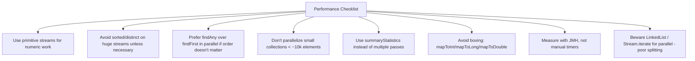

# 15. Performance

⬅ Back to [[00-Home]] | Prev: [[14-Optional-with-Streams]] | Next: [[16-Stream-vs-Collection]]

## General Rule

> **Streams are usually as fast as equivalent loops for simple pipelines, sometimes slightly slower due to lambda/functional-interface call overhead and lack of certain JIT optimizations — but the difference is negligible for most business logic. Measure, don't assume.**

## Where Streams Can Be Slower Than Loops

1. **Autoboxing** — `Stream<Integer>` boxes primitives; use `IntStream`/`LongStream`/`DoubleStream` instead (see [[13-Primitive-Streams]]).
2. **Lambda/functional interface call overhead** — each element goes through virtual dispatch via `Sink.accept()`. Usually optimized by JIT (especially with `invokedynamic` + monomorphic call sites), but can matter in ultra-hot loops.
3. **Object allocation for intermediate stages** — each stage wraps a `Sink`; for very simple loops over small arrays, plain `for` loops avoid this entirely.
4. **`sorted()`, `distinct()`** buffer the *entire* stream in memory — for huge streams this is a real cost, both in memory and latency (no elements emitted until buffering completes).

## Where Streams Can Be Faster

1. **Parallel streams on large, CPU-bound, easily-splittable workloads** (see [[11-Parallel-Streams]]).
2. **Short-circuiting** avoids unnecessary work loops might do the "hard way" (though a hand-written loop with an early `break` is equally fast).
3. **`summaryStatistics()`** computes 5 aggregate values in a single pass vs. 5 separate loop passes.

## Benchmarking Correctly with JMH

Never trust `System.currentTimeMillis()` micro-benchmarks — JIT warm-up, dead code elimination, and constant folding will lie to you. Use **JMH (Java Microbenchmark Harness)**:

```java
@BenchmarkMode(Mode.AverageTime)
@OutputTimeUnit(TimeUnit.NANOSECONDS)
@State(Scope.Thread)
public class StreamBenchmark {
    int[] data = new int[1_000_000];

    @Benchmark
    public long loopSum() {
        long sum = 0;
        for (int x : data) sum += x;
        return sum;
    }

    @Benchmark
    public long streamSum() {
        return IntStream.of(data).sum();
    }

    @Benchmark
    public long parallelStreamSum() {
        return IntStream.of(data).parallel().sum();
    }
}
```

## Practical Performance Checklist



## Memory Considerations

- Streams themselves are lightweight (no data buffering, except stateful ops like `sorted`/`distinct`).
- `.collect(Collectors.toList())` allocates a full result list — same as a manual loop building a list.
- Infinite streams (`Stream.generate`, `Stream.iterate`) consume **zero** memory for "future" elements — elements are generated on demand.

## Common Performance Myth-Busting

| Myth | Reality |
|---|---|
| "Streams are always faster" | False — for small collections and simple ops, loops are equal or faster. |
| "Parallel streams are always faster" | False — overhead of splitting/merging can dominate for small/cheap workloads. |
| "map+filter always creates intermediate lists" | False — Streams fuse operations per-element ([[05-Lazy-Evaluation]]); no intermediate collections unless you explicitly `.collect()` between stages. |
| "peek() is safe for debugging in production" | False — may be skipped by the JIT/optimizer in some cases; see [[18-Common-Bugs]]. |

## Interview Soundbite

> "Streams add a small constant overhead per element (lambda dispatch, sink chaining) versus a hand-written loop, but for typical business-logic-sized collections this is negligible and offset by clarity. Real gains come from avoiding autoboxing (use primitive streams), single-pass aggregation (`summaryStatistics`), and — only for large, CPU-bound, well-splitting sources — parallel streams, which should always be validated with a JMH benchmark rather than assumed."

Next: [[16-Stream-vs-Collection]]
