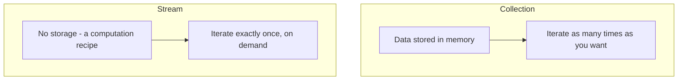
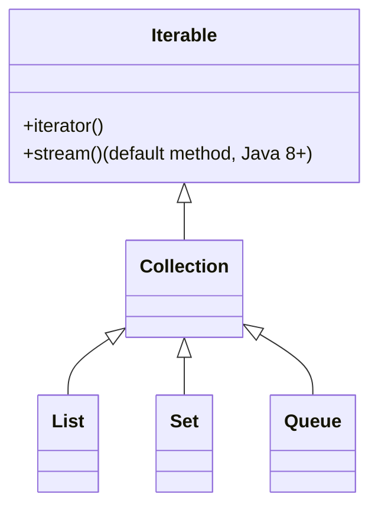

# 16. Stream vs Collection

⬅ Back to [[00-Home]] | Prev: [[15-Performance]] | Next: [[17-Stream-vs-Loop]]

## Fundamental Distinction

| | Collection | Stream |
|---|---|---|
| **Purpose** | Store & manage data (in-memory data structure) | Describe a computation over data |
| **Storage** | Yes — holds all elements in memory | No — computes elements on demand |
| **Iteration** | External (you write the loop) | Internal (library iterates; you supply behavior) |
| **Reusability** | Reusable any number of times | **Single-use** — consumed after terminal op |
| **Laziness** | N/A (eager by nature) | Intermediate ops lazy; terminal op eager |
| **Finite/Infinite** | Always finite | Can be infinite (`Stream.iterate`, `generate`) |
| **Mutation** | Add/remove elements freely | No mutation methods — a stream doesn't "add" |
| **When elements computed** | Elements exist before you access them | Elements computed **on demand**, as pulled by terminal op |
| **Traversal count** | Multiple traversals possible | Exactly one traversal |



## Analogy (Great for Interviews)

> "A `Collection` is like a **grocery list already written on paper** — you can read it as many times as you like. A `Stream` is like a **conveyor belt** — items pass by once, you act on each as it goes by, and once it's done, it's done."

## Code Illustrating the Difference

```java
List<Integer> collection = List.of(1, 2, 3);
System.out.println(collection.size());   // 3
System.out.println(collection.size());   // 3 (still works — reusable, holds data)

Stream<Integer> stream = collection.stream();
long count = stream.count();              // consumes the stream
// stream.count();                        // IllegalStateException: already operated upon or closed
```

## Streams Don't Replace Collections — They Complement Them

You typically:
1. **Store** data in a `Collection` (`List`, `Set`, `Map`).
2. **Stream** it to express a transformation/query declaratively.
3. **Collect** the result back into a `Collection` (via `Collectors`) if you need to store/reuse the output.

```java
List<String> source = List.of("a", "bb", "ccc");     // Collection: storage
List<String> result = source.stream()                 // Stream: computation
        .filter(s -> s.length() > 1)
        .collect(Collectors.toList());                 // back to Collection: storage
```

## Iterable vs Stream vs Collection Hierarchy


`Collection` extends `Iterable`, and `Iterable` gained a **default method** `stream()` in Java 8 — that's literally how existing collections "gained" streaming ability without breaking backward compatibility (a landmark API-evolution technique using default methods).

## Interview Soundbite

> "A Collection is an in-memory data structure supporting repeated, external iteration and mutation. A Stream is a one-shot, lazily-evaluated computation pipeline over a data source, using internal iteration, that can even represent infinite sequences. Collections answer 'what data do I have?'; Streams answer 'what do I want to compute from this data?'"

Next: [[17-Stream-vs-Loop]]
