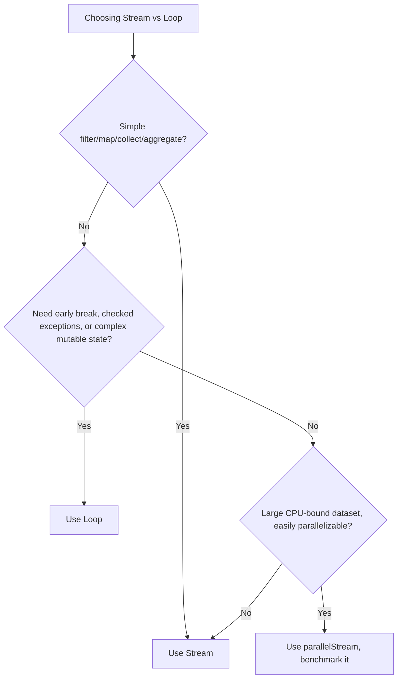

# 17. Stream vs Loop

⬅ Back to [[00-Home]] | Prev: [[16-Stream-vs-Collection]] | Next: [[18-Common-Bugs]]

## Side-by-Side Comparison

| Aspect | For-loop | Stream |
|---|---|---|
| Style | Imperative (how) | Declarative (what) |
| Readability for simple ops | Fine | Often clearer for chained transforms |
| Readability for complex, branching logic | Can be clearer! | Can become a "clever one-liner" that hurts readability |
| Debugging | Easy — step through with debugger | Harder — lambdas, no line-by-line breakpoints as naturally, need `peek` (careful, see [[18-Common-Bugs]]) |
| Early exit (`break`/`continue`) | Native `break`/`continue`/`return` | Must use `takeWhile`, `anyMatch`, `findFirst`, or restructure |
| Checked exceptions | Natural (declare/try-catch) | Awkward — lambdas can't throw checked exceptions without wrapping |
| Mutating local variables | Natural | Not allowed (must be effectively final) — this is a real design constraint |
| Parallelism | Manual (`ExecutorService`, threads) | Built-in (`.parallelStream()`) |
| Multiple outputs from one pass | Natural (add to several collections in one loop body) | Needs `teeing()` or multiple passes, or `Collectors.groupingBy`/`partitioningBy` tricks |

## Example: Same Logic, Both Styles

```java
// Loop
List<String> result = new ArrayList<>();
for (Employee e : employees) {
    if (e.getSalary() > 50000) {
        result.add(e.getName().toUpperCase());
    }
}

// Stream
List<String> result = employees.stream()
        .filter(e -> e.getSalary() > 50000)
        .map(Employee::getName)
        .map(String::toUpperCase)
        .toList();
```
For this kind of filter-map-collect logic, the Stream version is clearly more concise and communicates intent faster.

## Where Loops Win

### 1. Checked Exceptions
```java
// Loop: natural
for (String path : paths) {
    try {
        process(Files.readString(Path.of(path)));  // IOException is checked
    } catch (IOException e) {
        log.error("failed", e);
    }
}

// Stream: awkward — must wrap checked exception
paths.stream().forEach(path -> {
    try {
        process(Files.readString(Path.of(path)));
    } catch (IOException e) {
        throw new UncheckedIOException(e);  // wrap since lambda can't throw checked
    }
});
```

### 2. Early Exit with Complex Conditions / Multiple Breaks
```java
// Loop: simple nested break
outer:
for (Order o : orders) {
    for (Item i : o.getItems()) {
        if (i.isDefective()) {
            System.out.println("Found defect in order " + o.getId());
            break outer;
        }
    }
}
```
Streams have no direct equivalent of labeled `break` — you'd need `findFirst()` combined with `flatMap`, losing the early "order ID" context, or restructure entirely.

### 3. Mutating Local State Across Iterations
```java
// Loop: natural running total with conditional logic
int total = 0;
for (int n : nums) {
    if (n < 0) continue;
    total += n;
    if (total > 1000) break;
}

// Stream: awkward — no mutable local accumulator allowed;
// would require an AtomicInteger (code smell) or takeWhile tricks
```

## Where Streams Win

### 1. Multi-Stage Transformations
Chains of `filter → map → sorted → collect` read like a specification, top to bottom.

### 2. Parallelism
```java
// One line for CPU-bound parallel work:
double total = orders.parallelStream().mapToDouble(Order::getAmount).sum();
```

### 3. Composability & Reuse
Small stream-processing functions can be composed and reused; loop bodies are harder to extract and combine generically.

## Rule of Thumb (Best Practice)



## Interview Soundbite

> "Streams shine for declarative, chained data transformations and built-in parallelism; loops remain better for checked-exception-heavy code, complex early-exit logic, and mutable accumulator patterns. Neither is universally 'better' — the right choice depends on readability and the shape of the problem, and premature 'streamification' of everything can *reduce* clarity."

Next: [[18-Common-Bugs]]
