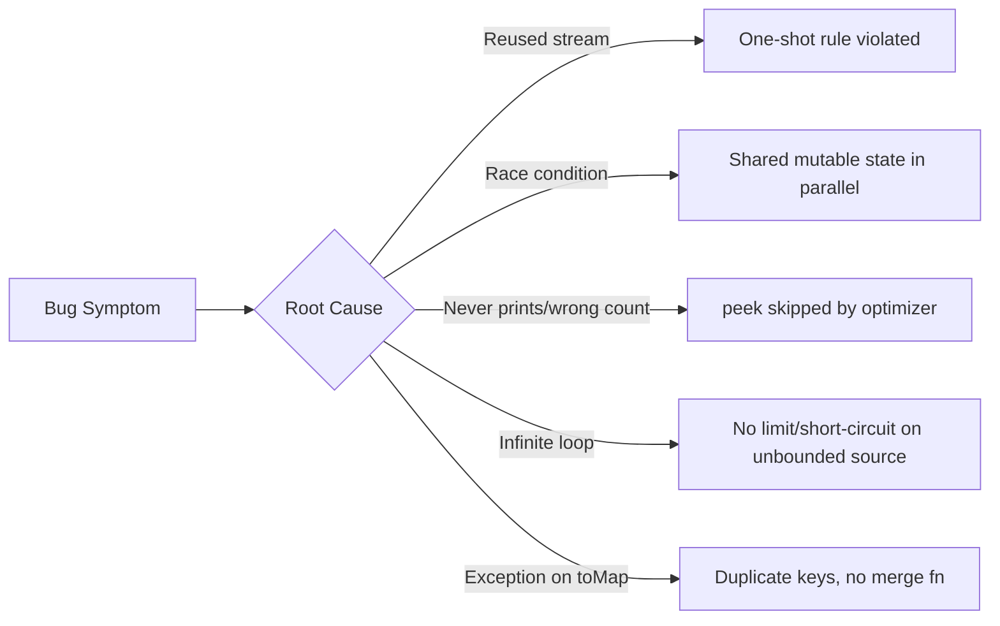

# 18. Common Bugs & Gotchas

⬅ Back to [[00-Home]] | Prev: [[17-Stream-vs-Loop]] | Next: [[19-Best-Practices]]

A curated list of real-world Stream bugs — favorite "spot the bug" interview material.

## 1. Reusing a Consumed Stream

```java
Stream<Integer> s = Stream.of(1, 2, 3);
s.forEach(System.out::println);
s.count(); // ❌ IllegalStateException: stream has already been operated upon or closed
```
**Fix:** Rebuild the stream from source each time (see [[04-Stream-Pipeline]]).

## 2. Unsafe Mutation of Shared State Inside `forEach` (Especially Parallel)

```java
List<Integer> result = new ArrayList<>();
nums.parallelStream().forEach(result::add);  // ❌ race condition, ArrayList isn't thread-safe
```
**Fix:** Use `collect(Collectors.toList())`, which handles thread-safety internally.

## 3. `reduce` with Mutable Accumulation on Parallel Streams

```java
List<Integer> list = nums.parallelStream()
    .reduce(new ArrayList<>(), (l, n) -> { l.add(n); return l; }, (l1, l2) -> { l1.addAll(l2); return l1; });
// ❌ Unsafe: same mutable list instance shared/mutated across threads
```
**Fix:** Use `collect()` for mutable reduction — see [[09-Reduce]].

## 4. `orElse` Eagerly Evaluates Its Argument

```java
String value = optional.orElse(expensiveDefaultCalculation()); // ❌ always runs, even if optional is present
```
**Fix:** `optional.orElseGet(() -> expensiveDefaultCalculation());`

## 5. Relying on `peek()` for Essential Side Effects

```java
long count = stream.peek(System.out::println).count(); // ❌ may not print anything if JVM can compute count() without traversal
```
**Fix:** Use `forEach` for side effects; reserve `peek` for debugging only.

## 6. Forgetting `distinct()` Uses `equals`/`hashCode`

```java
class Point { int x, y; } // no equals/hashCode overridden
List<Point> pts = List.of(new Point(1,1), new Point(1,1));
pts.stream().distinct().count(); // returns 2, not 1! (default Object identity equals)
```
**Fix:** Override `equals`/`hashCode`, or use a `record` (auto-generates both), or `distinct` by a key via `Collectors.toMap`.

## 7. `Collectors.toMap` Throws on Duplicate Keys

```java
Map<String, Employee> m = employees.stream()
        .collect(Collectors.toMap(Employee::getDept, e -> e)); // ❌ IllegalStateException if dept repeats
```
**Fix:** Provide a merge function: `Collectors.toMap(Employee::getDept, e -> e, (a, b) -> a)`.

## 8. Infinite Stream Without a Limiting/Short-Circuiting Op

```java
Stream.iterate(0, n -> n + 1).forEach(System.out::println); // ❌ never terminates
```
**Fix:** Always pair unbounded generators with `.limit(n)`, `.takeWhile(...)`, or a bounded `iterate` (3-arg overload, Java 9+).

## 9. Modifying the Source Collection During Stream Traversal

```java
List<String> list = new ArrayList<>(List.of("a", "b", "c"));
list.stream().forEach(s -> {
    if (s.equals("b")) list.remove(s); // ❌ ConcurrentModificationException
});
```
**Fix:** Collect first, then mutate; or use `removeIf` directly on the collection.

## 10. Using `findAny()` When Order Matters

```java
Optional<Integer> first = nums.parallelStream().filter(n -> n > 10).findAny(); // ❌ non-deterministic order in parallel
```
**Fix:** Use `findFirst()` if encounter order is semantically important.

## 11. Boxing Overhead from Not Using Primitive Streams

```java
int sum = list.stream().map(x -> x * 2).reduce(0, Integer::sum); // boxed the whole way
```
**Fix:** `list.stream().mapToInt(x -> x * 2).sum();`

## 12. Checked Exceptions Inside Lambdas

```java
list.stream().forEach(path -> Files.readString(Path.of(path))); // ❌ compile error: unhandled IOException
```
**Fix:** Wrap in try/catch and rethrow unchecked, or use a helper that converts checked exceptions.

## 13. Side-Effect-Only Lambdas in `map`

```java
stream.map(x -> { System.out.println(x); return x; }); // "map used as forEach" — code smell, no terminal op even called yet!
```
**Fix:** Use `peek` for observing (debug-only) or `forEach` as the actual terminal operation.

## 14. Capturing Mutable Local Variables (Compile Error, but often misunderstood)

```java
int total = 0;
list.forEach(n -> total += n); // ❌ compile error: variable used in lambda must be effectively final
```
**Fix:** Use `IntStream.sum()`, `reduce`, or an `AtomicInteger`/`int[]` box only as a last resort (and never on parallel streams without synchronization).

## 15. Assuming `.parallelStream()` Is Always Faster

```java
smallList.parallelStream().map(this::cheapOp).toList(); // often SLOWER than sequential due to overhead
```
**Fix:** Benchmark; parallelize only large, CPU-bound, well-splitting workloads — see [[11-Parallel-Streams]] and [[15-Performance]].

## Quick Reference: Bug → Root Cause → Fix



Next: [[19-Best-Practices]]
