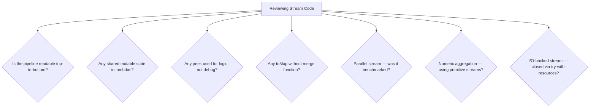

# 19. Best Practices

⬅ Back to [[00-Home]] | Prev: [[18-Common-Bugs]] | Next: [[20-Interview-Questions]]

## Golden Rules

1. **Keep lambdas pure (no side effects) whenever possible.** Especially for `filter`, `map`, and `reduce`/`collect` accumulators/combiners — this is what makes parallelization safe.
2. **Prefer method references over lambdas** when they're equivalent — `Employee::getName` over `e -> e.getName()` — for readability.
3. **Don't overuse streams for everything.** If a loop is clearer (checked exceptions, complex branching, early exits), use a loop. See [[17-Stream-vs-Loop]].
4. **Use primitive streams (`IntStream`/`LongStream`/`DoubleStream`) for numeric aggregation** to avoid boxing overhead.
5. **Never rely on `peek()` for business logic** — debug-only, may be skipped. See [[18-Common-Bugs]].
6. **Use `collect()`, not `reduce()`, for mutable accumulation** (Lists, Maps, StringBuilders).
7. **Prefer `orElseGet` over `orElse`** when the fallback is expensive to compute.
8. **Give `Collectors.toMap` a merge function** whenever keys might collide.
9. **Avoid parallel streams by default** — measure first, and only parallelize large, CPU-bound, well-splitting workloads. See [[11-Parallel-Streams]] and [[15-Performance]].
10. **Never mutate the stream's source while traversing it.**
11. **Break long pipelines into named intermediate variables or helper methods** when a chain exceeds ~4–5 operations, for readability:
```java
Stream<Employee> eligible = employees.stream()
        .filter(Employee::isActive)
        .filter(e -> e.getSalary() > threshold);

List<String> names = eligible
        .map(Employee::getName)
        .sorted()
        .toList();
```
12. **Use `var` for long generic Stream types** to reduce noise, but keep explicit types for public APIs.
13. **Favor `toList()` (Java 16+)** over `collect(Collectors.toList())` for brevity, unless you specifically need a mutable list (`toList()` returns an unmodifiable list).
14. **Close streams that wrap I/O resources** (`Files.lines()`) using try-with-resources:
```java
try (Stream<String> lines = Files.lines(path)) {
    lines.filter(l -> !l.isBlank()).forEach(System.out::println);
} // auto-closed, releasing the file handle
```
15. **Avoid deeply nested `flatMap` chains** — extract named helper methods for each transformation stage.
16. **Document non-obvious `Comparator` chains** — `Comparator.comparing(...).thenComparing(...).reversed()` chains can be subtle; a short comment saves the next reader time.
17. **Use `Collectors.groupingBy` with `TreeMap::new`** when you need deterministic, sorted-key output — `HashMap` (the default) has no order guarantee.
18. **Prefer immutability**: methods like `List.of()`, `toList()`, and `Collectors.toUnmodifiableList()` protect against accidental downstream mutation.
19. **Log/handle exceptions explicitly inside lambdas** rather than letting `RuntimeException` propagate silently through a long pipeline without context.
20. **Write unit tests around the *result*, not the internal pipeline shape** — Streams are meant to be refactored freely as long as behavior is unchanged.

## Code Review Checklist for Streams



## A Well-Structured Example (Put It All Together)

```java
public List<String> topEarnersByDepartment(List<Employee> employees, String department, int topN) {
    return employees.stream()
            .filter(e -> e.getDepartment().equals(department))
            .filter(Employee::isActive)
            .sorted(Comparator.comparingDouble(Employee::getSalary).reversed())
            .limit(topN)
            .map(Employee::getName)
            .toList();
}
```
Clear, linear, testable, and each stage names its intent.

## Interview Soundbite

> "Stream best practices boil down to: keep lambdas pure and side-effect-free, use the right tool (`collect` vs `reduce`, primitive vs boxed streams), don't parallelize without measuring, and don't force everything into a stream chain when a loop is clearer — readability and correctness come before cleverness."

Next: [[20-Interview-Questions]]
