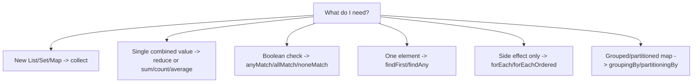

# 23. Cheat Sheet

⬅ Back to [[00-Home]] | Prev: [[22-Real-World-Examples]] | Next: [[24-Revision-Notes]]

## Creation

```java
Stream.of(1,2,3); Stream.empty(); Stream.ofNullable(x);
list.stream(); list.parallelStream(); Arrays.stream(arr);
Stream.iterate(seed, fn); Stream.iterate(seed, hasNext, fn); Stream.generate(supplier);
IntStream.range(0,n); IntStream.rangeClosed(0,n);
Files.lines(path); Pattern.compile(",").splitAsStream(line);
```

## Intermediate Operations

```java
filter(Predicate)      map(Function)        flatMap(Function<T,Stream<R>>)
mapToInt/Long/Double    distinct()           sorted() / sorted(Comparator)
peek(Consumer)          limit(n)             skip(n)
takeWhile(Predicate)    dropWhile(Predicate) boxed()
unordered()
```

## Terminal Operations

```java
forEach(Consumer)       forEachOrdered(Consumer)
toArray()               toList()  (Java 16+, immutable)
reduce(...)             collect(Collector)
count()                 anyMatch/allMatch/noneMatch(Predicate)
findFirst()             findAny()
min(Comparator)         max(Comparator)
sum()/average()/summaryStatistics() (primitive streams only)
```

## Collectors Quick Reference

```java
toList() toSet() toUnmodifiableList() toCollection(TreeSet::new)
toMap(k,v) toMap(k,v,merge) toMap(k,v,merge,mapSupplier)
joining() joining(delim) joining(delim,prefix,suffix)
counting() summingInt/Long/Double(fn) averagingInt/Long/Double(fn)
summarizingInt/Long/Double(fn) minBy(cmp) maxBy(cmp)
groupingBy(fn) groupingBy(fn,downstream) groupingBy(fn,mapFactory,downstream)
partitioningBy(pred) partitioningBy(pred,downstream)
mapping(fn,downstream) filtering(pred,downstream) (Java 9+)
reducing(...) collectingAndThen(collector,finisher) teeing(c1,c2,merger) (Java 12+)
```

## Reduce Overloads

```java
Optional<T> reduce(BinaryOperator<T> acc);
T reduce(T identity, BinaryOperator<T> acc);
<U> U reduce(U identity, BiFunction<U,T,U> acc, BinaryOperator<U> combiner);
```

## Optional Quick Reference

```java
isPresent() isEmpty() get() orElse(default) orElseGet(supplier)
orElseThrow() orElseThrow(supplierX) ifPresent(consumer)
ifPresentOrElse(consumer,runnable) map(fn) flatMap(fn) filter(pred)
stream() (Java 9+) or(supplier) (Java 9+)
// Primitive counterparts use getAsInt()/getAsLong()/getAsDouble()
```

## Comparator Chains

```java
Comparator.comparing(Person::getAge)
          .thenComparing(Person::getName)
          .reversed();
Comparator.comparingInt(String::length);
Comparator.naturalOrder(); Comparator.reverseOrder();
Comparator.nullsFirst(Comparator.naturalOrder());
```

## Parallel Streams

```java
list.parallelStream(); stream.parallel(); stream.sequential();
// Uses ForkJoinPool.commonPool() by default
customPool.submit(() -> stream.collect(...)).get(); // custom pool
```

## Common Gotcha Reminders (see [[18-Common-Bugs]])

- Stream is single-use: reusing → `IllegalStateException`.
- `orElse()` is eager; use `orElseGet()` for expensive defaults.
- `peek()` may be skipped by the optimizer — never use for essential logic.
- `Collectors.toMap` throws on duplicate keys without a merge function.
- Never mutate shared state inside `forEach` on a parallel stream — use `collect()`.
- `distinct()` needs `equals`/`hashCode` overridden for custom types.
- Always pair `Stream.iterate`/`generate` with `limit`/`takeWhile`.

## Decision Cheat Sheet



Next: [[24-Revision-Notes]]
