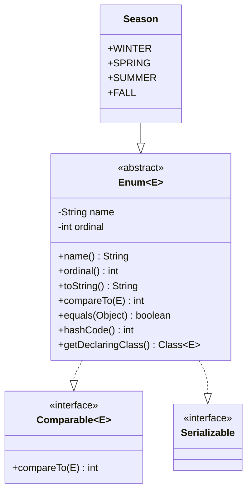
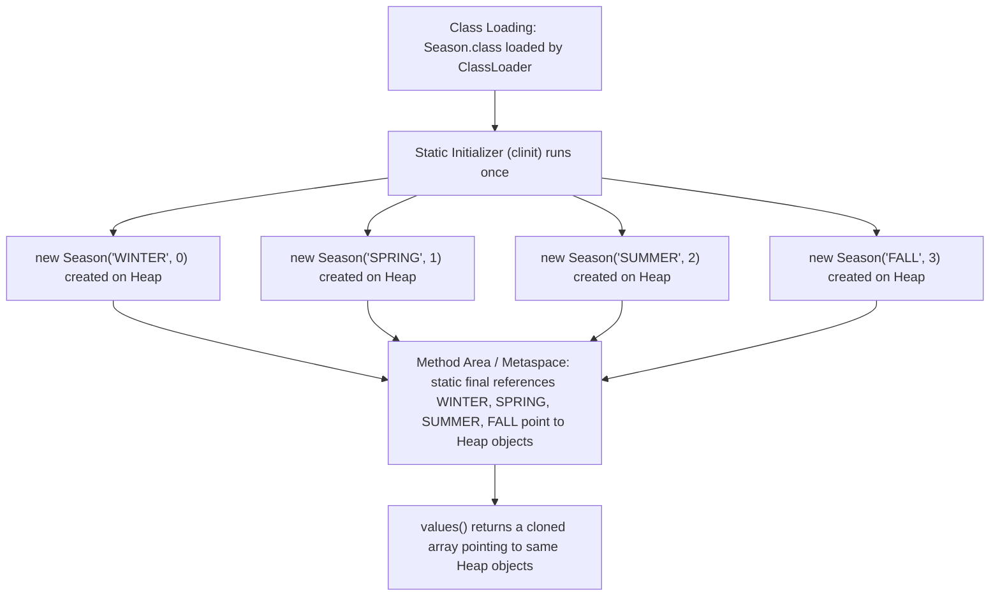
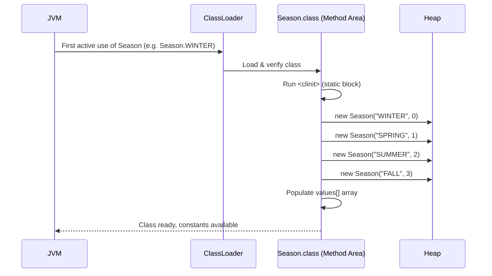
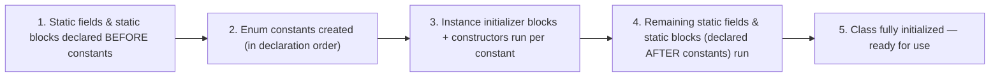
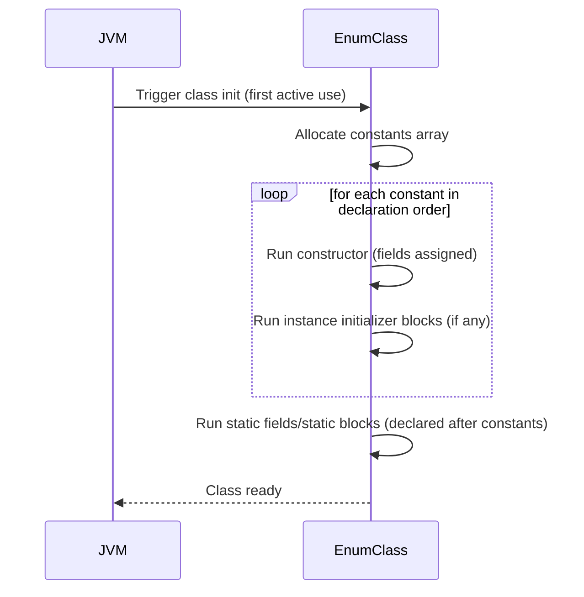
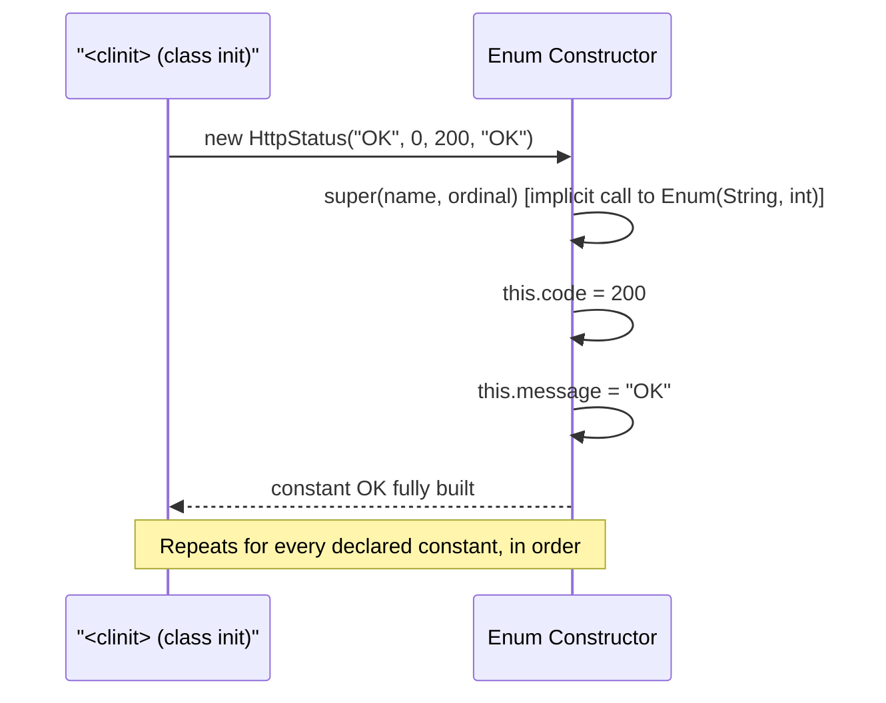
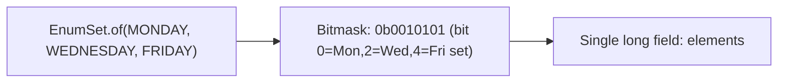
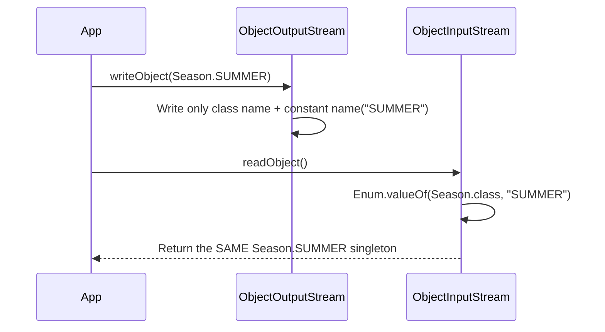
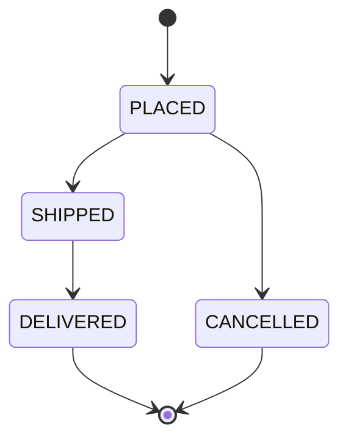

# Java Enum — Complete Master Guide 🎯

> [!IMPORTANT] This notebook is designed as a **permanent reference** — for interviews, university courses, competitive programming, and production engineering. Read it top to bottom once, then use it as a lookup tool forever.

---

## 📑 Table of Contents

1. [[#1. Introduction 📌|Introduction]]
2. [[#2. Internal Working 🚀|Internal Working]]
3. [[#3. Syntax|Syntax]]
4. [[#4. Anatomy of an Enum|Anatomy of an Enum]]
5. [[#5. Built-in Methods|Built-in Methods]]
6. [[#6. Constructors in Enum|Constructors in Enum]]
7. [[#7. Fields in Enum|Fields in Enum]]
8. [[#8. Methods in Enum|Methods in Enum]]
9. [[#9. Enum Constant-Specific Class Bodies|Constant-Specific Class Bodies]]
10. [[#10. Enum with Interfaces|Enum with Interfaces]]
11. [[#11. Enum with Switch|Enum with Switch]]
12. [[#12. EnumSet|EnumSet]]
13. [[#13. EnumMap|EnumMap]]
14. [[#14. Serialization|Serialization]]
15. [[#15. Reflection|Reflection]]
16. [[#16. Cloning|Cloning]]
17. [[#17. Comparable|Comparable]]
18. [[#18. Best Practices|Best Practices]]
19. [[#19. Common Mistakes ⚠️|Common Mistakes]]
20. [[#20. Performance Analysis|Performance Analysis]]
21. [[#21. Real-World Use Cases|Real-World Use Cases]]
22. [[#22. Design Patterns Using Enums|Design Patterns Using Enums]]
23. [[#23. Advanced Interview Questions|Advanced Interview Questions (50+)]]
24. [[#24. Coding Problems|Coding Problems]]
25. [[#25. Frequently Asked Questions|FAQs (30+)]]
26. [[#26. Cheat Sheet|Cheat Sheet]]
27. [[#27. Summary|Summary]]

---

# 1. Introduction 📌

## 1.1 What is an Enum?

- An **enum** (short for _enumeration_) is a special Java **reference type** introduced to represent a **fixed set of constants**.
- Declared using the `enum` keyword, introduced in **Java 5 (2004)** as part of JSR 201.
- Every enum in Java **implicitly extends `java.lang.Enum<E>`**, making it a full-fledged class — not a primitive, not merely a set of `int` labels.

> [!NOTE] An enum is a **class** whose instances are limited to a predefined, fixed number of named constants known at compile time.

## 1.2 Why Java Introduced Enums

Before Java 5, developers used the **"int constant" pattern**:

```java
public class Season {
    public static final int WINTER = 0;
    public static final int SPRING = 1;
    public static final int SUMMER = 2;
    public static final int FALL   = 3;
}
```

This pattern had serious flaws that Sun Microsystems (via Joshua Bloch, _Effective Java_) wanted to eliminate.

## 1.3 Historical Background

|Version|Milestone|
|---|---|
|Pre-Java 5|Int constants / String constants used to simulate enums|
|Java 5 (2004)|`enum` keyword introduced (JSR 201)|
|Java 7|Enums allowed in `switch` statements (already partly supported)|
|Java 8|Enums combined with Lambda/Streams for functional-style constant behavior|
|Java 14+|Switch **expressions** improve enum-based switching|
|Java 17|**Sealed classes** philosophically complement enums for closed hierarchies|
|Java 21|**Pattern matching for switch** enhances enum handling|

## 1.4 Problems Solved by Enums

> [!WARNING] Problems with the "int constant" pattern
> 
> - **No type safety** — any `int` can be passed where a `Season` was expected.
> - **No namespace** — constants pollute the containing class/global namespace.
> - **Fragile compilation** — constants are inlined at compile time; changing a value requires recompiling all dependent clients.
> - **No meaningful `toString()`** — printing `1` tells you nothing; you must maintain a manual lookup table.
> - **No way to iterate** over all constants.
> - **No way to add behavior** to a constant.

The **String constant pattern** (`"WINTER"`, `"SPRING"`, ...) fixed the printing problem but introduced **String comparison bugs**, typos, and no compile-time checking at all.

## 1.5 Difference Between Constants and Enums

|Feature|`public static final int`|`public static final String`|`enum`|
|---|---|---|---|
|Type safety|❌ No|❌ No|✅ Yes|
|Namespace|❌ Global/class-level|❌ Global/class-level|✅ Own type|
|Compile-time checking|❌|❌|✅|
|Can hold behavior (methods)|❌|❌|✅|
|Can implement interfaces|❌|❌|✅|
|Iterable (`values()`)|❌|❌|✅|
|Readable `toString()`|❌ (just a number)|✅ (but error-prone)|✅|
|Singleton guarantee|❌|❌|✅ (JVM enforced)|
|Switch-friendly|✅|❌ (pre-Java 7 no)|✅|

## 1.6 Why Enums Are Type-Safe

- Each enum constant is a **unique compile-time-known object** of the enum type — the compiler will reject any attempt to assign a value of a different type, or an out-of-range value, at **compile time**.
- Unlike `int` constants, there is **no implicit widening/narrowing** between an enum and any numeric type — you cannot accidentally pass `3` where a `Season` is expected.

```java
enum Season { WINTER, SPRING, SUMMER, FALL }

void checkSeason(Season s) { ... }

checkSeason(2);            // ❌ Compile-time error
checkSeason(Season.SUMMER); // ✅ Only valid values compile
```

> [!TIP] Interview Tip If asked "_Why are enums preferred over int constants?_" — answer with **type safety, namespacing, behavior encapsulation, and compiler-enforced exhaustiveness in switch statements**. This is the single most common enum interview opener.

**Related concepts:** [[#18. Best Practices|Best Practices]] · OOP Encapsulation · Generics (`Enum<E extends Enum<E>>`)

---

# 2. Internal Working 🚀

## 2.1 How the Compiler Converts an Enum

When you write:

```java
public enum Season {
    WINTER, SPRING, SUMMER, FALL
}
```

The compiler (`javac`) transforms it, conceptually, into something equivalent to:

```java
public final class Season extends Enum<Season> {

    public static final Season WINTER = new Season("WINTER", 0);
    public static final Season SPRING = new Season("SPRING", 1);
    public static final Season SUMMER = new Season("SUMMER", 2);
    public static final Season FALL   = new Season("FALL", 3);

    private static final Season[] VALUES = { WINTER, SPRING, SUMMER, FALL };

    private Season(String name, int ordinal) {
        super(name, ordinal);
    }

    public static Season[] values() {
        return VALUES.clone();
    }

    public static Season valueOf(String name) {
        return Enum.valueOf(Season.class, name);
    }
}
```

> [!IMPORTANT] The class is implicitly **`final`** (cannot be subclassed by user code) and implicitly **`extends java.lang.Enum<Season>`**. Since Java has **single inheritance**, this is exactly why an enum **cannot extend any other class**.

## 2.2 Bytecode-Level Explanation

Compiling the enum and running `javap -c -p Season.class` reveals:

- An `ACC_FINAL`, `ACC_SUPER`, `ACC_ENUM` access flag on the class.
- A **static initializer (`<clinit>`)** block that constructs each constant via `new` + `invokespecial` (calling the private constructor), then stores it into a `static final` field, and finally builds the private `values` array.
- The synthetic `values()` method **clones** this static array on every call (this is why calling `values()` repeatedly has a real, if small, performance cost).
- `valueOf(String)` delegates to `Enum.valueOf(Class, String)`, which performs a reflective lookup into an internal map built once per class from `Class.getEnumConstantsShared()`.

```
Compiled from "Season.java"
final class Season extends java.lang.Enum<Season> {
  public static final Season WINTER;
  public static final Season SPRING;
  public static final Season SUMMER;
  public static final Season FALL;
  public static Season[] values();
  public static Season valueOf(java.lang.String);
  static {};   // <clinit> — builds all constants
}
```

## 2.3 Relationship with `java.lang.Enum`

- `java.lang.Enum<E extends Enum<E>>` is an **abstract class** (not an interface) that all enums implicitly extend.
- It uses the **recursive/bounded self-type generic pattern** `<E extends Enum<E>>` (sometimes called the "curiously recurring generic pattern") so that `compareTo()` and other methods are type-safe for the specific enum subtype.
- `Enum` itself implements `Comparable<E>` and `Serializable`.



## 2.4 Why Enums Cannot Extend Another Class

- Java supports **only single class inheritance**.
- The compiler already inserts `extends java.lang.Enum<E>` for you.
- Therefore, the inheritance slot is **used up** — an enum can never `extends` a user-defined class.

> [!WARNING] Common Misconception Enums _can_ still be extended **internally by the compiler itself** for constant-specific class bodies (see [[#9. Enum Constant-Specific Class Bodies|Section 9]]) — that mechanism is different from user-level `extends`.

## 2.5 Why Enums Can Implement Interfaces

- Since interfaces don't participate in the single-inheritance restriction, an enum **can implement any number of interfaces**.
- This is the foundation of the **Strategy Pattern with Enums** (see [[#22. Design Patterns Using Enums|Section 22]]).

```java
interface Discountable {
    double applyDiscount(double price);
}

enum Membership implements Discountable {
    GOLD, SILVER, BRONZE;

    public double applyDiscount(double price) {
        return switch (this) {
            case GOLD -> price * 0.8;
            case SILVER -> price * 0.9;
            case BRONZE -> price * 0.95;
        };
    }
}
```

## 2.6 How Enum Constants Become Singleton Objects

- Each constant (`WINTER`, `SPRING`, ...) is instantiated **exactly once**, inside the enum class's **static initializer**, which the JVM guarantees runs **only once per classloader**, in a **thread-safe** manner (class initialization is synchronized by the JVM specification, §12.4.2).
- Because the constructor is **implicitly `private`**, no external code can call `new Season(...)` — this is what makes the singleton **unbreakable** (compare to the classic Singleton pattern, which can be broken via reflection or serialization — enums are immune, see [[#14. Serialization|Section 14]] and [[#15. Reflection|Section 15]]).

## 2.7 Memory Representation



- Enum constant objects live on the **Heap**, exactly like any other object.
- The **references** (`WINTER`, `SPRING`, ...) are stored as `static final` fields in the **Method Area / Metaspace** (class-level storage), shared across the entire JVM for that classloader.
- Because they are singletons, **`==` comparison is always safe and equivalent to `.equals()`** for enums.

## 2.8 JVM Behavior & Object Creation Lifecycle



> [!EXAMPLE] Enum initialization is **lazy at the class level** (only happens on first active use of the class) but **eager at the constant level** (ALL constants are created together, not one-by-one as needed).

**Related concepts:** [[#4. Anatomy of an Enum|Anatomy]] · Class Loading (JVM) · Singleton Design Pattern · [[#14. Serialization|Serialization]] · [[#15. Reflection|Reflection]]

---

# 3. Syntax

## 3.1 Basic Enum

```java
public enum Day {
    MONDAY, TUESDAY, WEDNESDAY, THURSDAY, FRIDAY, SATURDAY, SUNDAY
}
```

- Simplest possible enum. Each constant is comma-separated, terminated by a semicolon (optional if nothing follows).

## 3.2 Enum with Variables (Fields)

```java
public enum Planet {
    MERCURY(3.303e+23, 2.4397e6),
    VENUS(4.869e+24, 6.0518e6),
    EARTH(5.976e+24, 6.37814e6);

    private final double mass;   // in kilograms
    private final double radius; // in meters

    Planet(double mass, double radius) {
        this.mass = mass;
        this.radius = radius;
    }

    double surfaceGravity() {
        final double G = 6.67300E-11;
        return G * mass / (radius * radius);
    }
}
```

## 3.3 Enum with Constructor

- Constructors are **always implicitly `private`** (or package-private is disallowed — only `private` is legal).
- Called once per constant during class initialization.

```java
public enum Level {
    LOW(1), MEDIUM(5), HIGH(10);

    private final int weight;

    Level(int weight) { this.weight = weight; }

    public int getWeight() { return weight; }
}
```

## 3.4 Enum with Methods

```java
public enum Operation {
    ADD, SUBTRACT;

    public int apply(int a, int b) {
        return switch (this) {
            case ADD -> a + b;
            case SUBTRACT -> a - b;
        };
    }
}
```

## 3.5 Enum Implementing Interfaces

```java
interface Describable {
    String describe();
}

public enum Status implements Describable {
    ACTIVE, INACTIVE;

    public String describe() {
        return "Status is: " + name();
    }
}
```

## 3.6 Nested Enum (Inside a Class)

```java
public class Order {
    public enum OrderStatus { PLACED, SHIPPED, DELIVERED, CANCELLED }

    private OrderStatus status;
}
```

- Automatically `static` even without the keyword (all nested enums are implicitly static — they cannot be inner/non-static classes).

## 3.7 Top-Level Enum

```java
// File: Season.java
public enum Season { WINTER, SPRING, SUMMER, FALL }
```

- One `public` top-level enum per `.java` file, filename must match the enum name — same rule as classes.

## 3.8 Enum Inside an Interface

```java
interface Vehicle {
    enum FuelType { PETROL, DIESEL, ELECTRIC, HYBRID }
}
```

- Legal. Implicitly `public static`.

## 3.9 Package-Level (Package-Private) Enum

```java
enum InternalCode { OK, RETRY, FAIL }  // no modifier → package-private
```

> [!TIP] Interview Tip Know that an enum declared inside a class/interface is **implicitly static** — you can never make it non-static, because there is no "outer instance" concept for enum constants.

**Related concepts:** [[#6. Constructors in Enum|Constructors]] · [[#7. Fields in Enum|Fields]] · Nested/Inner Classes (OOP)

---

# 4. Anatomy of an Enum

## 4.1 Components

|Component|Description|
|---|---|
|Enum constants|The fixed instances (`WINTER`, `SPRING`, ...) — must be declared **first**|
|Constructor|Implicitly `private`; initializes fields per constant|
|Instance fields|State attached to each constant|
|Instance methods|Behavior shared or overridden per constant|
|Static methods|Utility methods scoped to the enum type|
|Static fields|Shared state across all constants|
|Static blocks|Run once during class initialization, after constants are built|
|Abstract methods|Force each constant to provide its own implementation (see [[#9. Enum Constant-Specific Class Bodies|

## 4.2 Initialization Order



> [!WARNING] Common Mistake Enum constants are constructed **before** any static field declared **after** them, but static fields declared **before** the constant list (rare, and constants must still come first syntactically) are unusual. In practice: **all enum constants are always initialized before any other static initializer that appears after the constant list**, because constants must be the first thing in the body.

```java
public enum Config {
    DEV, PROD;

    static {
        System.out.println("Static block running. DEV=" + DEV);
        // DEV is already fully constructed here.
    }
}
```

**Output:**

```
Static block running. DEV=DEV
```

## 4.3 Execution Order Diagram (Full Lifecycle)



**Related concepts:** [[#2. Internal Working 🚀|Internal Working]] · [[#6. Constructors in Enum|Constructors]] · Static vs Instance Initialization (OOP)

---

# 5. Built-in Methods

> [!NOTE] All methods below are inherited from `java.lang.Enum<E>` unless marked _(compiler-synthesized, per-enum)_.

## 5.1 `values()` _(compiler-synthesized, per-enum)_

|||
|---|---|
|**Definition**|Returns an array containing all constants of the enum, in declaration order|
|**Syntax**|`public static E[] values()`|
|**Parameters**|None|
|**Return type**|`E[]` (array of the enum type)|
|**Complexity**|O(n) — clones the internal array every call|
|**Internal working**|Compiler stores a private static `$VALUES` array; `values()` returns `$VALUES.clone()` to protect against external mutation|
|**Real-world use**|Iterating over all statuses to build a dropdown, validating input, generating documentation|
|**Interview Q**|_"Is `values()` expensive if called in a loop?"_ — Yes, because it clones the array every single call; cache the result if reused.|

```java
for (Season s : Season.values()) {
    System.out.println(s);
}
```

**Output:** `WINTER SPRING SUMMER FALL` (one per line)

> [!WARNING] Common Mistake Calling `values()` inside a hot loop (e.g., millions of iterations) creates millions of array clones. Cache it: `private static final Season[] ALL = Season.values();`

## 5.2 `valueOf(String)` _(compiler-synthesized + `Enum.valueOf`)_

|||
|---|---|
|**Definition**|Returns the enum constant matching the given name **exactly** (case-sensitive)|
|**Syntax**|`public static E valueOf(String name)`|
|**Parameters**|`name` — must exactly match a declared constant|
|**Return type**|`E`|
|**Complexity**|O(1) amortized (backed by an internal `Map` built via reflection, cached in `Class`)|
|**Throws**|`IllegalArgumentException` if no matching constant exists; `NullPointerException` if `name` is null|
|**Real-world use**|Parsing enums from JSON/DB strings, deserialization|

```java
Season s = Season.valueOf("SUMMER"); // OK
Season bad = Season.valueOf("summer"); // ❌ throws IllegalArgumentException
```

> [!TIP] Interview Tip `valueOf` is **case-sensitive** and does **not trim whitespace**. Always validate/sanitize external input before calling it, or wrap in try/catch.

## 5.3 `ordinal()`

|||
|---|---|
|**Definition**|Returns the **zero-based position** of the constant in its declaration|
|**Syntax**|`public final int ordinal()`|
|**Return type**|`int`|
|**Complexity**|O(1) — simply reads a stored field|
|**Real-world use**|Rarely should be used directly in business logic (see [[#19. Common Mistakes ⚠️|

```java
Season.SUMMER.ordinal(); // returns 2
```

> [!WARNING] Never persist `ordinal()` to a database or use it for business logic — reordering/inserting constants silently shifts every subsequent ordinal, corrupting data with **no compiler warning**.

## 5.4 `name()`

|||
|---|---|
|**Definition**|Returns the exact constant name as declared in source code|
|**Syntax**|`public final String name()`|
|**Return type**|`String`|
|**Complexity**|O(1)|
|**Difference from `toString()`**|`name()` is `final` and **cannot be overridden**; `toString()` **can** be overridden and defaults to calling `name()`|

```java
Season.SUMMER.name();     // "SUMMER"
Season.SUMMER.toString(); // "SUMMER" unless overridden
```

> [!TIP] Interview Tip _"What's the difference between `name()` and `toString()`?"_ — `name()` is final/immutable and always reflects the source-declared identifier; `toString()` is overridable for display purposes. **Prefer `name()`** when you need the guaranteed, unmodified constant identifier (e.g., for `valueOf` round-tripping).

## 5.5 `compareTo(E)`

|||
|---|---|
|**Definition**|Compares constants based on **ordinal** (declaration order)|
|**Syntax**|`public final int compareTo(E o)`|
|**Return type**|`int` (negative, zero, positive)|
|**Complexity**|O(1)|
|**Internal working**|`return this.ordinal - other.ordinal;`|

```java
Season.WINTER.compareTo(Season.SUMMER); // negative (0 - 2 = -2)
```

## 5.6 `equals(Object)`

|||
|---|---|
|**Definition**|Identity comparison (`==`) — `Enum` does **not** override value-based equality|
|**Syntax**|`public final boolean equals(Object other)`|
|**Internal working**|`return this == other;`|
|**Why final**|Prevents subclasses from breaking the singleton equality contract|

> [!IMPORTANT] Because each constant is a **singleton**, `==` and `.equals()` are **functionally identical** for enums — but prefer `.equals()` in generic/collection code, and prefer `==` for direct, readable comparisons. Never use `.equals()` on a possibly-null enum without a null check — actually `==` is null-safe (`null == Season.WINTER` is simply `false`), while `x.equals(y)` throws `NullPointerException` if `x` is null.

## 5.7 `hashCode()`

|||
|---|---|
|**Definition**|Returns the JVM identity hash code (from `Object`), **not** based on name or ordinal|
|**Syntax**|`public final int hashCode()`|
|**Why**|Consistent with singleton identity; safe to use in `HashMap`/`HashSet`, though `EnumMap`/`EnumSet` are preferred for performance|

## 5.8 `toString()`

|||
|---|---|
|**Definition**|Default implementation returns `name()`; **can be overridden** (unlike `name()`)|
|**Syntax**|`public String toString()`|
|**Real-world use**|Custom display labels, e.g., `"Gold Member"` instead of `GOLD`|

```java
public enum Membership {
    GOLD, SILVER, BRONZE;

    @Override
    public String toString() {
        return name().charAt(0) + name().substring(1).toLowerCase();
    }
}
// Membership.GOLD.toString() -> "Gold"
```

> [!WARNING] Common Mistake If you override `toString()`, **`valueOf()` still requires the original `name()`**, not the overridden string. Don't try to `valueOf("Gold")` if the constant is named `GOLD`.

## 5.9 `getDeclaringClass()`

|||
|---|---|
|**Definition**|Returns the `Class` object representing the enum type — important for constant-specific bodies, where `getClass()` would return the **anonymous subclass**, not the enum itself|
|**Syntax**|`public final Class<E> getDeclaringClass()`|

```java
enum Op {
    PLUS { public int apply(int a, int b) { return a + b; } };
    public abstract int apply(int a, int b);
}

Op.PLUS.getClass();            // Op$1  (anonymous subclass!)
Op.PLUS.getDeclaringClass();   // Op    (the actual enum type)
```

> [!TIP] Interview Tip This is a favorite "gotcha" question — always use `getDeclaringClass()`, never `getClass()`, when you need the enum's true type in constant-specific-body scenarios.

**Related concepts:** [[#12. EnumSet|EnumSet]] · [[#13. EnumMap|EnumMap]] · [[#17. Comparable|Comparable]]

---

# 6. Constructors in Enum

## 6.1 Why Constructors Are Private

- Enum constants are a **closed, fixed set** known entirely at compile time.
- Allowing external `new` calls would break the **singleton guarantee** and the entire type-safety model.
- The compiler **enforces** this: writing `public` or `protected` on an enum constructor is a **compile-time error**.

```java
enum Status {
    ACTIVE, INACTIVE;
    public Status() {}   // ❌ Compile-time error: modifier not allowed
}
```

## 6.2 Implicit Private Constructor

```java
enum Direction { NORTH, SOUTH, EAST, WEST }
// Compiler inserts: private Direction() {}
```

## 6.3 Explicit Constructor

```java
enum Direction {
    NORTH, SOUTH, EAST, WEST;
    Direction() { System.out.println("Constructing " + this); } // package-private = private for enums
}
```

## 6.4 Parameterized Constructor

```java
enum HttpStatus {
    OK(200, "OK"),
    NOT_FOUND(404, "Not Found"),
    SERVER_ERROR(500, "Internal Server Error");

    private final int code;
    private final String message;

    HttpStatus(int code, String message) {
        this.code = code;
        this.message = message;
    }

    public int getCode() { return code; }
    public String getMessage() { return message; }
}
```

## 6.5 Multiple (Overloaded) Constructors

```java
enum Priority {
    LOW,                 // uses default weight
    MEDIUM(5),
    HIGH(10, "Urgent");

    private final int weight;
    private final String label;

    Priority() { this(1, "Normal"); }
    Priority(int weight) { this(weight, "Normal"); }
    Priority(int weight, String label) {
        this.weight = weight;
        this.label = label;
    }
}
```

## 6.6 Constructor Execution Flow



> [!IMPORTANT] Must Remember Every enum constructor **implicitly calls `super(name, ordinal)`** first — this is how `Enum.name()` and `Enum.ordinal()` get their values. You never write this `super()` call yourself; the compiler inserts it.

**Related concepts:** [[#4. Anatomy of an Enum|Anatomy]] · [[#7. Fields in Enum|Fields]] · Constructor Overloading (OOP)

---

# 7. Fields in Enum

## 7.1 `final` Fields (Recommended)

```java
enum Currency {
    USD("$"), EUR("€"), INR("₹");
    private final String symbol;
    Currency(String symbol) { this.symbol = symbol; }
    public String getSymbol() { return symbol; }
}
```

- `final` fields set once in the constructor → **immutable, thread-safe constants**. This is the **recommended default**.

## 7.2 Mutable Fields (Use with Caution)

```java
enum Counter {
    INSTANCE;
    private int count = 0;
    public void increment() { count++; }
    public int get() { return count; }
}
```

> [!WARNING] Common Mistake Mutable fields turn an enum constant into **shared, mutable global state** — every part of the application sees the same object. This can introduce subtle concurrency bugs unless properly synchronized. Prefer immutability unless you specifically want a **thread-safe global singleton counter/registry** (and even then, use `AtomicInteger`).

## 7.3 Static Fields

```java
enum Color {
    RED, GREEN, BLUE;
    static int totalAccessed = 0;
    Color access() { totalAccessed++; return this; }
}
```

- Shared across **all** constants — one copy per enum class, not per constant.

## 7.4 Constants (within the Enum)

```java
enum MathConstant {
    PI(3.14159), E(2.71828);
    public final double value;
    MathConstant(double value) { this.value = value; }
}
```

## 7.5 Encapsulation

> [!TIP] Interview Tip Best practice: keep fields `private final`, expose via public getter methods — exactly like a normal well-designed class. Enums are classes; **OOP encapsulation rules still apply**.

**Related concepts:** [[#6. Constructors in Enum|Constructors]] · [[#18. Best Practices|Best Practices]] · Immutability (OOP)

---

# 8. Methods in Enum

## 8.1 Instance Methods

```java
enum Currency {
    USD, EUR, INR;
    String prefixed(double amount) { return name() + " " + amount; }
}
```

## 8.2 Static Methods

```java
enum Currency {
    USD, EUR, INR;
    static Currency fromSymbol(String symbol) {
        return switch (symbol) {
            case "$" -> USD;
            case "€" -> EUR;
            case "₹" -> INR;
            default -> throw new IllegalArgumentException("Unknown symbol: " + symbol);
        };
    }
}
```

## 8.3 Abstract Methods

```java
enum Operation {
    ADD { public int apply(int a, int b) { return a + b; } },
    SUBTRACT { public int apply(int a, int b) { return a - b; } };

    public abstract int apply(int a, int b);
}
```

- Declaring a method `abstract` **forces every constant** to supply its own body — the compiler will reject any constant that omits it.

## 8.4 Overridden Methods

```java
enum Vehicle {
    CAR, BIKE;

    @Override
    public String toString() {
        return "Vehicle: " + name().toLowerCase();
    }
}
```

## 8.5 Custom Behavior Per Constant

See full treatment in [[#9. Enum Constant-Specific Class Bodies|Section 9]] — this is one of the most powerful and most interview-tested enum features.

**Related concepts:** [[#9. Enum Constant-Specific Class Bodies|Constant-Specific Bodies]] · Polymorphism (OOP) · Abstract Classes

---

# 9. Enum Constant-Specific Class Bodies

## 9.1 What They Are

- When a constant is followed by `{ ... }`, the compiler generates an **anonymous subclass** of the enum, specific to that one constant.
- This allows **per-constant method overriding** — true polymorphism among enum constants.

```java
enum Operation {
    ADD("+") {
        public double apply(double a, double b) { return a + b; }
    },
    SUBTRACT("-") {
        public double apply(double a, double b) { return a - b; }
    },
    MULTIPLY("*") {
        public double apply(double a, double b) { return a * b; }
    },
    DIVIDE("/") {
        public double apply(double a, double b) {
            if (b == 0) throw new ArithmeticException("Division by zero");
            return a / b;
        }
    };

    private final String symbol;
    Operation(String symbol) { this.symbol = symbol; }

    public abstract double apply(double a, double b);

    @Override
    public String toString() { return symbol; }
}
```

**Usage:**

```java
for (Operation op : Operation.values()) {
    System.out.printf("4 %s 2 = %.1f%n", op, op.apply(4, 2));
}
```

**Expected Output:**

```
4 + 2 = 6.0
4 - 2 = 2.0
4 * 2 = 8.0
4 / 2 = 2.0
```

## 9.2 Internal Implementation

```mermaid
classDiagram
    class Operation {
        <<abstract-ish base>>
        -String symbol
        +apply(double, double) double*
    }
    class Operation$1 {
        <<anonymous subclass for ADD>>
        +apply(double, double) double
    }
    class Operation$2 {
        <<anonymous subclass for SUBTRACT>>
        +apply(double, double) double
    }
    Operation <|-- Operation$1
    Operation <|-- Operation$2
```

- Each constant-specific body compiles to a **separate synthetic class file** (`Operation$1.class`, `Operation$2.class`, ...), each extending `Operation` and overriding `apply()`.
- `Operation.ADD.getClass()` returns `Operation$1`, **not** `Operation` — this is why `getDeclaringClass()` exists (see [[#5. Built-in Methods|Section 5.9]]).
- Because each constant becomes technically a _different runtime class_, the enum class itself is implicitly **non-final** internally in bytecode when any constant-specific body exists (though still un-subclassable by user code — the compiler blocks `extends Operation`).

> [!EXAMPLE] This pattern **replaces the classic `switch`-based polymorphism** and is Joshua Bloch's recommended alternative to giant `switch` statements scattered throughout a codebase (_Effective Java_, Item 38).

> [!TIP] Interview Tip _"How would you implement a calculator using enums instead of switch-case?"_ — This is the textbook answer. Mention **constant-specific class bodies** and **abstract methods**.

**Related concepts:** [[#10. Enum with Interfaces|Enum with Interfaces]] · [[#22. Design Patterns Using Enums|Strategy Pattern]] · Polymorphism

---

# 10. Enum with Interfaces

## 10.1 Why Interfaces Are Allowed

- Enums cannot extend classes (single inheritance already used by `Enum`), but Java interfaces are designed for **multiple implementation** — so `enum X implements A, B, C` is fully legal.

## 10.2 Real-World Example

```java
interface Taxable {
    double tax(double amount);
}

enum TaxBracket implements Taxable {
    LOW(0.05), MEDIUM(0.15), HIGH(0.30);

    private final double rate;
    TaxBracket(double rate) { this.rate = rate; }

    @Override
    public double tax(double amount) { return amount * rate; }
}
```

## 10.3 Strategy Pattern Using Enums

```java
interface ShippingStrategy {
    double calculate(double weightKg);
}

enum ShippingMethod implements ShippingStrategy {
    STANDARD { public double calculate(double weightKg) { return weightKg * 2.0; } },
    EXPRESS  { public double calculate(double weightKg) { return weightKg * 5.0 + 10; } },
    OVERNIGHT { public double calculate(double weightKg) { return weightKg * 8.0 + 25; } };
}

// Client code:
double cost = ShippingMethod.EXPRESS.calculate(3.2);
```

- This is the canonical **Strategy Pattern** implemented with **zero extra classes** — the enum _is_ the strategy family.

> [!IMPORTANT] This pattern is heavily used in real Spring Boot codebases for **payment gateways, shipping calculators, notification channels, and discount engines**.

**Related concepts:** [[#22. Design Patterns Using Enums|Design Patterns]] · [[#9. Enum Constant-Specific Class Bodies|Constant-Specific Bodies]] · Interfaces (OOP)

---

# 11. Enum with Switch

## 11.1 Classic Switch (Java ≤ 6 style, still valid)

```java
Season s = Season.SUMMER;
switch (s) {
    case WINTER: System.out.println("Cold"); break;
    case SUMMER: System.out.println("Hot"); break;
    default: System.out.println("Mild");
}
```

- Note: case labels use the **bare constant name** (`WINTER`), never `Season.WINTER` — using the qualified name is a compile-time error.

## 11.2 Enhanced Switch (Java 12+, arrow syntax)

```java
String result = switch (s) {
    case WINTER -> "Cold";
    case SUMMER -> "Hot";
    default -> "Mild";
};
```

## 11.3 Switch Expressions with `yield`

```java
int score = switch (s) {
    case WINTER, FALL -> 1;
    case SPRING -> {
        int base = 5;
        yield base + 2;
    }
    case SUMMER -> 10;
};
```

## 11.4 Pattern Matching for Switch (Java 21, where applicable)

```java
sealed interface Shape permits Circle, Square {}
record Circle(double r) implements Shape {}
record Square(double s) implements Shape {}

// Enums combine naturally with pattern matching guards:
String describe(Season s) {
    return switch (s) {
        case Season sn when sn == Season.SUMMER -> "Beach time";
        case Season sn -> "Just " + sn;
    };
}
```

> [!NOTE] Enum switches don't need `null` handling pre-Java 21, but since Java 21 you can add `case null ->` explicitly inside a switch expression for enums (previously, a `null` enum reference always threw `NullPointerException` at the switch statement itself).

## 11.5 Exhaustiveness

> [!IMPORTANT] Must Remember A **switch expression** (not a switch statement) over an enum **must be exhaustive** — cover all constants or provide a `default`. The compiler enforces this, which is a major advantage over `if-else` chains.

**Related concepts:** [[#19. Common Mistakes ⚠️|Common Mistakes]] · Sealed Classes · Pattern Matching

---

# 12. EnumSet

## 12.1 What It Is

- `EnumSet<E>` is a specialized `Set` implementation **exclusively for enum types**, part of `java.util`.
- Abstract class with two package-private concrete implementations chosen automatically:
    - `RegularEnumSet` — used when the enum has **≤ 64 constants** (the common case)
    - `JumboEnumSet` — used when the enum has **> 64 constants**

## 12.2 Internal Implementation — Bit Vector Representation

- `RegularEnumSet` stores membership in a **single `long` (64-bit) bitmask**, where bit `i` represents whether `values()[i]` is present in the set.
- `JumboEnumSet` uses a `long[]` array of bitmasks to scale beyond 64 constants.



## 12.3 Why It's Fast

|Operation|EnumSet|HashSet|
|---|---|---|
|`add()`|O(1) — single bitwise OR|O(1) amortized, but with hashing overhead|
|`contains()`|O(1) — single bitwise AND|O(1) amortized, hashing + equals|
|`remove()`|O(1) — bitwise AND with complement|O(1) amortized|
|Memory|Extremely compact (one `long` for ≤64 constants)|Much larger (hash table buckets, node objects)|
|Iteration order|Natural (declaration) order, always|Undefined|

## 12.4 Methods & Examples

```java
enum Day { MON, TUE, WED, THU, FRI, SAT, SUN }

EnumSet<Day> weekdays = EnumSet.range(Day.MON, Day.FRI);
EnumSet<Day> weekend  = EnumSet.of(Day.SAT, Day.SUN);
EnumSet<Day> all      = EnumSet.allOf(Day.class);
EnumSet<Day> none     = EnumSet.noneOf(Day.class);
EnumSet<Day> notMon   = EnumSet.complementOf(EnumSet.of(Day.MON));
```

|Method|Purpose|
|---|---|
|`allOf(Class)`|Set containing every constant|
|`noneOf(Class)`|Empty set|
|`of(E...)`|Set of specified constants|
|`range(E, E)`|All constants between two (inclusive)|
|`complementOf(EnumSet)`|Everything **not** in the given set|
|`copyOf(Collection)`|Build from existing collection|

## 12.5 Real-World Use Case

```java
enum Permission { READ, WRITE, EXECUTE, DELETE }

EnumSet<Permission> adminPerms = EnumSet.allOf(Permission.class);
EnumSet<Permission> guestPerms = EnumSet.of(Permission.READ);

if (adminPerms.contains(Permission.DELETE)) {
    // grant access
}
```

- Classic use: **permission/role flags**, replacing legacy bitmask `int` flags (`0x01 | 0x02`) with a type-safe equivalent.

> [!TIP] Interview Tip _"Why prefer `EnumSet` over `HashSet<Enum>`?"_ — Answer: **speed (bitwise ops), memory compactness, guaranteed iteration order matching declaration order.**

**Related concepts:** [[#13. EnumMap|EnumMap]] · Bit Manipulation · Collections Framework

---

# 13. EnumMap

## 13.1 What It Is

- `EnumMap<K extends Enum<K>, V>` is a specialized `Map` implementation for enum keys, backed internally by a **plain array** indexed by `ordinal()`.

## 13.2 Internal Implementation

```java
// Simplified internal structure:
private transient Object[] vals; // array sized to keyType.getEnumConstants().length
```

- `put(key, value)` internally does `vals[key.ordinal()] = value`.
- `get(key)` does `return vals[key.ordinal()]`.
- No hashing, no collision resolution, no boxing overhead for the key.

## 13.3 Why Faster Than HashMap

|Aspect|`EnumMap`|`HashMap<Enum, V>`|
|---|---|---|
|Key lookup|Direct array index via `ordinal()` — O(1), no hashing|Hash computation + bucket traversal — O(1) amortized but with more overhead|
|Memory|Single flat array, size = number of constants|Hash table with buckets, load factor, resizing|
|Iteration order|Always natural (declaration) order|Undefined (unless `LinkedHashMap`)|
|Null keys|❌ Not allowed (`NullPointerException`)|✅ Allowed (one null key)|

## 13.4 Time Complexity

|Operation|EnumMap|HashMap|
|---|---|---|
|`get`/`put`/`remove`|O(1) — true constant time, no amortization|O(1) average, O(n) worst case (bad hash distribution)|
|Iteration|O(n), always in declaration order|O(capacity + size)|

## 13.5 Use Cases

```java
enum Day { MON, TUE, WED, THU, FRI, SAT, SUN }

EnumMap<Day, String> schedule = new EnumMap<>(Day.class);
schedule.put(Day.MON, "Gym");
schedule.put(Day.WED, "Yoga");

for (Map.Entry<Day, String> entry : schedule.entrySet()) {
    System.out.println(entry.getKey() + " -> " + entry.getValue());
}
```

**Output** (always in `Day` declaration order):

```
MON -> Gym
WED -> Yoga
```

> [!IMPORTANT] Must Remember Always prefer `EnumMap` over `HashMap` when the key type is an enum — it is strictly faster and more memory-efficient with no downside, unless you specifically need a `null` key.

**Related concepts:** [[#12. EnumSet|EnumSet]] · [[#20. Performance Analysis|Performance Analysis]] · Collections Framework

---

# 14. Serialization

## 14.1 Why Enums Are Serialization-Safe

- Java **special-cases enum serialization**. Instead of serializing all fields, the JVM writes **only the constant's `name()`**.
- On deserialization, `readObject()` is replaced by a call to `Enum.valueOf(enumClass, name)` — meaning **deserialization always returns the exact same singleton instance**, never a new object.

> [!IMPORTANT] This is precisely why **"enum singleton"** is considered the _only_ Singleton implementation that is 100% safe against serialization-based singleton-breaking attacks (a classic weakness of hand-written Singleton classes).

## 14.2 Singleton Guarantee

```java
public enum ConfigManager {
    INSTANCE;
    private final Map<String, String> settings = new HashMap<>();
    public String get(String key) { return settings.get(key); }
}
```

- Serialize and deserialize `ConfigManager.INSTANCE` any number of times — you always get back the **same object reference** (`==` holds true).

## 14.3 `readResolve()`

- Normal classes use `readResolve()` to enforce singleton behavior after deserialization; **enums don't need to**, because the JVM's enum-specific serialization mechanism already guarantees it internally.
- Writing a custom `readResolve()` in an enum is legal but **redundant and discouraged**.

## 14.4 JVM Behavior



**Related concepts:** [[#2. Internal Working 🚀|Internal Working]] · [[#22. Design Patterns Using Enums|Singleton Pattern]] · [[#15. Reflection|Reflection]]

---

# 15. Reflection

## 15.1 Reflection Restrictions

- `Class.newInstance()` (deprecated) and `Constructor.newInstance()` **explicitly throw `IllegalArgumentException`** when the target class is an enum — this check is hard-coded into the JDK.

```java
Constructor<Season> ctor = Season.class.getDeclaredConstructor(String.class, int.class);
ctor.setAccessible(true);
ctor.newInstance("HACKED", 99); // ❌ throws IllegalArgumentException: "Cannot reflectively create enum objects"
```

## 15.2 Why Reflection Cannot Create Enum Objects

- `java.lang.reflect.Constructor.newInstance()` contains an explicit runtime check:
    
    ```java
    if ((clazz.getModifiers() & Modifier.ENUM) != 0)    throw new IllegalArgumentException("Cannot reflectively create enum objects");
    ```
    
- This closes the **last remaining loophole** that could otherwise break the singleton guarantee (reflection is famously used to break classic Singleton implementations — enums are immune).

> [!TIP] Interview Tip _"How do enums guarantee singleton behavior against both serialization AND reflection attacks?"_ — Two separate JVM/JDK-level protections: special enum serialization (Section 14) + explicit reflection block in `Constructor.newInstance()`.

**Related concepts:** [[#14. Serialization|Serialization]] · [[#16. Cloning|Cloning]] · [[#22. Design Patterns Using Enums|Singleton Pattern]]

---

# 16. Cloning

## 16.1 Why `clone()` Is Prohibited

- `java.lang.Enum` overrides `clone()` and makes it `final`, throwing `CloneNotSupportedException` unconditionally:
    
    ```java
    protected final Object clone() throws CloneNotSupportedException {    throw new CloneNotSupportedException();}
    ```
    
- This is the **third** layer of singleton protection (alongside serialization-safety and reflection-blocking).

## 16.2 Singleton Protection Summary

|Attack Vector|Protection Mechanism|
|---|---|
|`new` from outside|Implicit `private` constructor|
|Reflection (`Constructor.newInstance`)|Hard-coded JVM check blocks enum instantiation|
|Serialization/Deserialization|Special enum serialization writes/reads only the name|
|`clone()`|`Enum.clone()` is `final` and always throws|

> [!IMPORTANT] Must Remember Enums are the **only construct in Java that provides a fully JVM-enforced singleton across all four attack vectors** simultaneously. This is why _Effective Java_ recommends **"a single-element enum type is the best way to implement a singleton."**

**Related concepts:** [[#14. Serialization|Serialization]] · [[#15. Reflection|Reflection]] · [[#22. Design Patterns Using Enums|Singleton Pattern]]

---

# 17. Comparable

## 17.1 Natural Ordering

- `Enum<E>` implements `Comparable<E>`, so all enums have a **natural ordering based on declaration order (`ordinal`)** by default — no extra code required.

```java
List<Season> seasons = new ArrayList<>(List.of(Season.SUMMER, Season.WINTER, Season.SPRING));
Collections.sort(seasons); // sorts by ordinal: WINTER, SPRING, SUMMER
```

## 17.2 `ordinal()` and `compareTo()`

```java
public final int compareTo(E o) {
    return this.ordinal - o.ordinal; // simplified
}
```

> [!WARNING] Common Mistake Relying on `compareTo()`/natural ordering couples your **sort order to declaration order** — reordering constants in source silently changes sort behavior everywhere. If business logic requires custom ordering, use an explicit `Comparator` (e.g., comparing by a field, not ordinal).

```java
Comparator<Priority> byWeight = Comparator.comparingInt(p -> p.weight);
```

**Related concepts:** [[#5. Built-in Methods|Built-in Methods]] · [[#19. Common Mistakes ⚠️|Common Mistakes]] · Generics

---

# 18. Best Practices

> [!TIP] Best Practices Checklist
> 
> - ✅ Use **UPPER_SNAKE_CASE** for constant names (`ACTIVE`, `PENDING_REVIEW`).
> - ✅ Keep fields `private final` — favor immutability.
> - ✅ Provide meaningful getters instead of exposing raw fields.
> - ✅ Use constant-specific class bodies instead of long `switch`/`if-else` chains when behavior differs per constant.
> - ✅ Implement interfaces to enable Strategy-pattern-style polymorphism.
> - ✅ Place each top-level enum in its own file, matching Java class-file conventions.
> - ✅ Group related enums into a dedicated `enums` or `domain` package for discoverability.
> - ✅ Prefer `EnumMap`/`EnumSet` over `HashMap`/`HashSet` when keys are enums.
> - ✅ Use `valueOf()` defensively — wrap in try/catch when parsing external/untrusted input.
> - ✅ Document each constant with a `//` or Javadoc comment when its meaning isn't obvious.
> - ✅ Use `name()` (not `toString()`) for persistence/serialization round-tripping.

## 18.1 Naming Conventions

|Element|Convention|Example|
|---|---|---|
|Enum type name|UpperCamelCase, singular noun|`OrderStatus`, `PaymentMethod`|
|Constants|UPPER_SNAKE_CASE|`PENDING`, `IN_PROGRESS`|
|Methods|lowerCamelCase|`getWeight()`, `applyDiscount()`|

## 18.2 Organization & Package Structure

```
com.example.app
 └── domain
      └── enums
           ├── OrderStatus.java
           ├── PaymentMethod.java
           └── UserRole.java
```

## 18.3 Immutability

- Prefer `final` fields set only in constructors.
- Avoid public setters on enum fields — if state must change, encapsulate through controlled methods (and consider whether an enum is even the right tool).

## 18.4 Clean Code Practices

- Keep constant-specific bodies short; extract complex logic into private helper methods or separate classes if bodies grow large.
- Avoid overloading a single enum to represent two unrelated concepts (e.g., don't mix `OrderStatus` and `PaymentStatus` into one enum).

**Related concepts:** [[#7. Fields in Enum|Fields]] · [[#19. Common Mistakes ⚠️|Common Mistakes]] · Clean Code Principles

---

# 19. Common Mistakes ⚠️

## 19.1 Using `ordinal()` for Business Logic

```java
// ❌ BAD
int priority = level.ordinal(); // breaks silently if constants are reordered

// ✅ GOOD
int priority = level.getWeight(); // explicit field, immune to reordering
```

> [!WARNING] `ordinal()` is meant for **internal collection optimization** (`EnumSet`/`EnumMap`), not for external contracts, database storage, or business rules. Adding a new constant in the middle of the list silently shifts every ordinal after it — with **zero compiler errors**.

## 19.2 Comparing Enums with Strings

```java
// ❌ BAD — fragile, no compile-time checking
if (status.name().equals("ACTIVE")) { ... }

// ✅ GOOD — type-safe
if (status == Status.ACTIVE) { ... }
```

## 19.3 Mutable Fields Without Synchronization

```java
// ❌ RISKY in multithreaded contexts
enum Counter { INSTANCE; int count = 0; void inc() { count++; } }

// ✅ SAFER
enum Counter { INSTANCE; private final AtomicInteger count = new AtomicInteger(); void inc() { count.incrementAndGet(); } }
```

## 19.4 Business Logic Misuse (God Enums)

- ❌ Stuffing unrelated responsibilities (validation, persistence mapping, UI labels, business rules) into a single enum makes it a "God Object" in disguise.
- ✅ Keep enums focused purely on **representing a fixed set of values** plus minimal, closely-related behavior.

## 19.5 Persisting Ordinal in a Database

> [!WARNING] Common Mistake Storing `ordinal()` in a DB column is one of the **most common production bugs**. Always store `name()` (a `String`) or an explicit numeric `code` field defined by you — **never the JVM-managed ordinal**.

## 19.6 Forgetting `default` in Switch Statements (non-exhaustive risk)

```java
// Adding a new enum constant later can silently fall through with no default
switch (status) {
    case ACTIVE: ...; break;
    case INACTIVE: ...; break;
    // New constant PENDING added later — falls through silently in classic switch statements!
}
```

> [!TIP] Prefer **switch expressions** (`->` syntax) — the compiler forces exhaustiveness and will flag missing cases at compile time.

## 19.7 Calling `values()` Repeatedly in Hot Paths

```java
// ❌ Clones array every call
for (int i = 0; i < 1_000_000; i++) {
    process(Season.values());
}

// ✅ Cache once
private static final Season[] SEASONS = Season.values();
```

**Related concepts:** [[#5. Built-in Methods|Built-in Methods]] · [[#11. Enum with Switch|Enum with Switch]] · [[#20. Performance Analysis|Performance Analysis]]

---

# 20. Performance Analysis

## 20.1 Enum vs String vs int Constants

|Criterion|`enum`|`String` constant|`int` constant|
|---|---|---|---|
|**Type safety**|✅ Full compile-time safety|⚠️ Weak (any string compiles)|❌ None (any int compiles)|
|**Memory**|Moderate (object per constant, created once)|Higher (String pool, but often duplicated in interned strings)|Lowest (primitive, inlined at compile time)|
|**Speed — comparison**|Fastest (`==` reference compare, O(1))|Slower (`.equals()` does char-by-char compare)|Fast (`==` primitive compare) but no safety net|
|**Speed — switch**|Fast (compiled to jump table via ordinal-based lookup)|Slower (hashCode + equals under the hood)|Fastest raw switch, but unsafe|
|**Maintainability**|✅ High — self-documenting, IDE autocomplete|❌ Prone to typos|❌ Magic numbers, no meaning without comments|
|**Readability**|✅ Excellent|⚠️ OK|❌ Poor (`if (status == 2)`)|
|**Extensibility (add behavior)**|✅ Native support|❌ None|❌ None|
|**Serialization safety**|✅ Built-in singleton guarantee|➖ N/A|➖ N/A|

## 20.2 Detailed Notes

- **Memory:** Enum constants are created once and reused (singleton) — for a small fixed set, this is negligible overhead versus `int`, and _less_ overhead than repeatedly interning/comparing Strings.
- **Speed:** Enum `==` comparison is a simple reference/pointer comparison — as fast as `int ==`, and safer.
- **Switch performance:** The JVM compiles enum switches using a synthetic lookup table (`$SwitchMap$...`) mapping `ordinal()` to case indices — very close to raw `int` switch performance, with type safety intact.

> [!TIP] Interview Tip _"Is using enums slower than using int constants?"_ — In practice, the difference is **negligible for typical applications**; the type-safety and maintainability benefits vastly outweigh the microscopic overhead of object references vs primitives.

**Related concepts:** [[#12. EnumSet|EnumSet]] · [[#13. EnumMap|EnumMap]] · [[#1. Introduction 📌|Introduction]]

---

# 21. Real-World Use Cases

## 21.1 Payment Status

```java
public enum PaymentStatus {
    PENDING, AUTHORIZED, CAPTURED, FAILED, REFUNDED;
}
```

## 21.2 Order Status (with allowed-transition logic)

```java
public enum OrderStatus {
    PLACED, SHIPPED, DELIVERED, CANCELLED;

    public boolean canTransitionTo(OrderStatus next) {
        return switch (this) {
            case PLACED -> next == SHIPPED || next == CANCELLED;
            case SHIPPED -> next == DELIVERED;
            default -> false;
        };
    }
}
```

## 21.3 User Roles & Permissions

```java
public enum UserRole {
    ADMIN(EnumSet.allOf(Permission.class)),
    EDITOR(EnumSet.of(Permission.READ, Permission.WRITE)),
    VIEWER(EnumSet.of(Permission.READ));

    private final EnumSet<Permission> permissions;
    UserRole(EnumSet<Permission> permissions) { this.permissions = permissions; }
    public boolean has(Permission p) { return permissions.contains(p); }
}
enum Permission { READ, WRITE, DELETE }
```

## 21.4 HTTP Methods

```java
public enum HttpMethod { GET, POST, PUT, PATCH, DELETE, HEAD, OPTIONS }
```

## 21.5 Database Mappings (JPA / Hibernate)

```java
@Entity
public class Order {
    @Enumerated(EnumType.STRING)   // ✅ Recommended over EnumType.ORDINAL
    private OrderStatus status;
}
```

> [!WARNING] Common Mistake `@Enumerated(EnumType.ORDINAL)` stores the **ordinal integer** in the DB — extremely fragile (see [[#19. Common Mistakes ⚠️|Section 19.5]]). Always prefer `EnumType.STRING` for JPA entities.

## 21.6 Spring Boot / REST APIs

```java
@RestController
@RequestMapping("/orders")
class OrderController {
    @GetMapping("/{id}/status")
    OrderStatus getStatus(@PathVariable Long id) { ... }
}
```

- Spring's Jackson integration automatically serializes/deserializes enums to/from their `name()` as JSON strings.

## 21.7 Microservices — State Machines



## 21.8 Logging Levels

```java
public enum LogLevel { TRACE, DEBUG, INFO, WARN, ERROR, FATAL }
```

## 21.9 Feature Flags

```java
public enum FeatureFlag {
    NEW_CHECKOUT_FLOW, DARK_MODE, BETA_SEARCH;
}
```

**Related concepts:** [[#12. EnumSet|EnumSet]] · [[#13. EnumMap|EnumMap]] · [[#22. Design Patterns Using Enums|Design Patterns]]

---

# 22. Design Patterns Using Enums

## 22.1 Singleton Pattern

```java
public enum ConfigManager {
    INSTANCE;
    private final Properties props = new Properties();
    public String get(String key) { return props.getProperty(key); }
}
```

- The **gold-standard Singleton** implementation — see [[#16. Cloning|Section 16]] for why it's unbreakable.

## 22.2 Strategy Pattern

```java
interface CompressionStrategy { byte[] compress(byte[] data); }

enum Compressor implements CompressionStrategy {
    GZIP { public byte[] compress(byte[] data) { /* gzip logic */ return data; } },
    ZIP  { public byte[] compress(byte[] data) { /* zip logic */ return data; } };
}
```

## 22.3 State Pattern

```java
enum TrafficLightState {
    RED { TrafficLightState next() { return GREEN; } },
    GREEN { TrafficLightState next() { return YELLOW; } },
    YELLOW { TrafficLightState next() { return RED; } };

    abstract TrafficLightState next();
}
```

## 22.4 Factory Pattern

```java
enum ShapeFactory {
    CIRCLE { Shape create() { return new Circle(); } },
    SQUARE { Shape create() { return new Square(); } };

    abstract Shape create();
}
interface Shape {}
class Circle implements Shape {}
class Square implements Shape {}
```

## 22.5 Command Pattern

```java
interface Command { void execute(); }

enum EditorCommand implements Command {
    SAVE { public void execute() { System.out.println("Saving..."); } },
    UNDO { public void execute() { System.out.println("Undoing..."); } };
}
```

**Related concepts:** [[#9. Enum Constant-Specific Class Bodies|Constant-Specific Bodies]] · [[#10. Enum with Interfaces|Enum with Interfaces]] · Gang of Four Design Patterns

---

# 23. Advanced Interview Questions

> [!QUESTION] How to use this section Each question includes the **expected depth** an interviewer at OCP/Senior level looks for. Don't just memorize answers — understand the _why_.

**1. What is an enum in Java, and what type of construct is it under the hood?** A: A special class type; every enum implicitly extends `java.lang.Enum<E>`. _(Expectation: mention it's a full class, not a primitive.)_

**2. Why can't an enum extend another class?** A: Java has single inheritance, and the compiler already inserts `extends Enum<E>`.

**3. Can an enum implement an interface?** A: Yes, any number of interfaces — interfaces aren't subject to single-inheritance limits.

**4. Is the enum constructor implicitly private, or can it be public?** A: Always implicitly `private`; explicit `public`/`protected` modifiers are compile errors.

**5. How does the JVM guarantee enum constants are singletons?** A: Constants are created once inside the class's static initializer (`<clinit>`), which the JVM runs exactly once, thread-safely, per classloader.

**6. What happens if you try to reflectively instantiate an enum constant?** A: `Constructor.newInstance()` throws `IllegalArgumentException` — the JDK has a hard-coded enum check.

**7. Why is `clone()` disabled for enums?** A: `Enum.clone()` is `final` and always throws `CloneNotSupportedException`, protecting the singleton guarantee.

**8. How are enums serialized differently from normal objects?** A: Only the constant's `name()` is written; deserialization calls `Enum.valueOf()`, always returning the same singleton.

**9. What is the difference between `name()` and `toString()`?** A: `name()` is `final`, immutable, reflects source declaration. `toString()` is overridable, defaults to `name()`.

**10. What does `ordinal()` return, and why should it rarely be used directly?** A: Zero-based declaration position; fragile because reordering/inserting constants silently shifts values.

**11. How does `compareTo()` work for enums?** A: Subtracts ordinals — natural ordering follows declaration order.

**12. Are enum `equals()` and `hashCode()` overridable?** A: No — both are `final` in `Enum`, based on object identity.

**13. Can two different enum constants ever be `==` equal?** A: No — each is a unique singleton object.

**14. What's the internal implementation of `EnumSet`?** A: A bit vector (`long` for ≤64 constants via `RegularEnumSet`, `long[]` via `JumboEnumSet` beyond that).

**15. Why is `EnumMap` faster than `HashMap` for enum keys?** A: Backed by a plain array indexed via `ordinal()` — no hashing, no collisions.

**16. Can an `EnumMap` have a null key?** A: No, throws `NullPointerException`.

**17. What's the difference between constant-specific class bodies and a switch statement for varying behavior?** A: Constant-specific bodies use compile-time-enforced polymorphism (every constant must implement the abstract method); switch relies on runtime branching and manual exhaustiveness.

**18. Why does `getClass()` behave unexpectedly on a constant with a class body?** A: It returns the anonymous subclass (e.g., `Op$1`), not the enum type — use `getDeclaringClass()` instead.

**19. Can an enum have abstract methods?** A: Yes, forcing each constant to override them via constant-specific bodies.

**20. Is it legal to declare an enum inside a method (local enum)?** A: Yes, as of Java 16 local enums are legal (previously only local classes/records had partial restrictions); however this is uncommon in practice.

**21. Can an enum be generic (e.g., `enum Foo<T>`)?** A: No — Java enums cannot declare their own type parameters.

**22. Why is the Enum Singleton pattern considered superior to the classic lazy/eager Singleton?** A: JVM-enforced protection against reflection, serialization, and cloning attacks simultaneously — impossible to break without extreme measures (e.g. Unsafe).

**23. What access modifier can enum constructors have?** A: Only `private` (explicit) or none (implicit private) — no `public`/`protected`/`default`.

**24. How would you model a finite state machine using enums?** A: Constant-specific abstract `next()` methods, each constant transitioning to the next logical state.

**25. Difference between `Enum.valueOf()` throwing behavior vs a Map-based lookup?** A: `valueOf()` throws `IllegalArgumentException` on mismatch, requires exact case-sensitive match, and is O(1) via cached internal map — you might wrap it for graceful fallback.

**26. Can you have duplicate enum constant names?** A: No — compile-time error, since constants are effectively static final fields sharing one namespace.

**27. What's the significance of `Enum<E extends Enum<E>>`?** A: A self-referential (bounded) generic ensuring type-safe `compareTo` and singleton behavior specific to the concrete enum subtype.

**28. Why can't you instantiate an enum with `new`?** A: Constructor is private and only invocable from within the compiler-generated static initializer.

**29. What's the output of printing an enum constant directly (`System.out.println(Season.SUMMER)`)?** A: Calls `toString()`, which defaults to `name()` — prints `SUMMER`.

**30. Can enum constants have different constructors within the same enum?** A: Yes — overloaded constructors are allowed, and different constants may invoke different overloads.

**31. What happens if `values()` is called concurrently from multiple threads?** A: Safe — each call independently clones the internal array; no shared mutable state is exposed.

**32. Is an enum thread-safe by default?** A: The class initialization and constant creation are thread-safe (JVM-guaranteed); however, **mutable instance fields** inside a constant are not automatically thread-safe.

**33. How do you implement the Strategy pattern with enums?** A: Enum implements a strategy interface; each constant supplies constant-specific body logic (see Section 22.2).

**34. Why should `EnumType.ORDINAL` be avoided in JPA?** A: Reordering constants silently corrupts stored data with no compile-time warning; `EnumType.STRING` is far more resilient.

**35. Can an enum have a `main()` method?** A: Yes — enums are classes and can have any static method, including `main`.

**36. What is the return type of `values()` and is it safe to mutate?** A: An array (`E[]`); it's a defensive **clone**, so mutating the returned array does **not** affect the enum's internal state.

**37. How does exhaustiveness checking work for switch expressions on enums?** A: The compiler verifies every constant is covered (or a `default`/pattern exists); missing cases fail to compile for switch **expressions** (not classic switch statements).

**38. Difference between `Enum` and `sealed class` for representing closed sets of types?** A: Enums represent a fixed set of **values** (singletons of the same type); sealed classes represent a fixed set of **distinct types**, each potentially with different state/shape.

**39. Can you add a constant to an enum without breaking binary compatibility?** A: Adding constants is generally safe for source compatibility but can break binary compatibility for code compiled against the old switch statement (missing `default`) or that relies on `ordinal()`.

**40. What does `getDeclaringClass()` return for a constant without a class body?** A: The enum type itself (same as `getClass()` in that case, since there's no anonymous subclass).

**41. How is an enum's static initializer different from a regular class's?** A: It must construct all declared constants **before** running any other static initializer written after the constant list.

**42. Are enum constants eagerly or lazily initialized?** A: Eagerly, but only when the enum class itself is first actively used (class-level laziness, constant-level eagerness).

**43. What's the memory location of enum constant objects?** A: The Heap, like all objects; their references live as `static final` fields in Method Area/Metaspace.

**44. Can an interface reference an enum constant in a default method?** A: Yes, provided the interface has access to the enum type; no special restriction.

**45. What exception is thrown by `valueOf()` for an unmatched name?** A: `IllegalArgumentException` (not `NoSuchElementException`).

**46. Is `Enum` an interface or an abstract class?** A: An **abstract class** (`java.lang.Enum<E>`), not an interface.

**47. Why must enum constants be declared first in the body?** A: Language-specification rule — clarifies the constant list from other class-body members and ensures correct compilation/initialization order.

**48. How would you version an enum used in a public API without breaking existing clients?** A: Prefer adding new constants at the end; avoid removing/reordering; use `EnumType.STRING` for persistence; consider a `default`/fallback case in all switch logic.

**49. What's a "constant-specific class body" and when should you use it over a switch?** A: An anonymous subclass per constant overriding a method; use it when behavior fundamentally differs per constant and you want compiler-enforced completeness.

**50. Compare Enum-based Singleton vs classic static-field Singleton in terms of security.** A: Enum Singleton resists reflection, serialization, and cloning attacks by JVM-level guarantees; classic Singletons require manual defenses (`readResolve()`, throwing in constructor, etc.) and remain more fragile.

**51. (Bonus) Can enums be used as Map keys directly without `EnumMap`?** A: Yes, any `Map` implementation works since `Enum` has valid `hashCode()`/`equals()`, but `EnumMap` is strictly more efficient.

**52. (Bonus) What happens when an enum constant list is empty (`enum Empty {}`)?** A: Legal — `values()` returns an empty array; useful in rare marker-type scenarios.

> [!TIP] Interviewer Expectation Summary Senior-level interviewers expect you to connect **language rules → bytecode/JVM reasoning → real-world consequence** for every answer, not just recite definitions.

---

# 24. Coding Problems

## 🟢 Easy

### Problem 1: Days Until Weekend

**Problem:** Given a `Day` enum, compute how many days remain until Saturday.

```java
enum Day { MON, TUE, WED, THU, FRI, SAT, SUN }

static int daysUntilWeekend(Day day) {
    int diff = Day.SAT.ordinal() - day.ordinal();
    return diff < 0 ? diff + 7 : diff;
}
```

- **Explanation:** Uses `ordinal()` safely here because it's a **local, transient calculation**, not persisted or exposed externally.
- **Time Complexity:** O(1) · **Space Complexity:** O(1)
- **When to use:** Quick internal calculations within a single method's scope.
- **When not to use:** Never expose or persist the ordinal-based result as a stable contract.

### Problem 2: Enum from String Safely

**Problem:** Convert a `String` to an enum constant, returning `Optional.empty()` if invalid, instead of throwing.

```java
static <E extends Enum<E>> Optional<E> safeValueOf(Class<E> type, String name) {
    try {
        return Optional.of(Enum.valueOf(type, name));
    } catch (IllegalArgumentException | NullPointerException e) {
        return Optional.empty();
    }
}
```

- **Time Complexity:** O(1) amortized · **Space Complexity:** O(1)

---

## 🟡 Medium

### Problem 3: Traffic Light State Machine

**Problem:** Model a traffic light that cycles RED → GREEN → YELLOW → RED using constant-specific bodies.

```java
enum TrafficLight {
    RED { public TrafficLight next() { return GREEN; } },
    GREEN { public TrafficLight next() { return YELLOW; } },
    YELLOW { public TrafficLight next() { return RED; } };

    public abstract TrafficLight next();
}

// Simulate 5 transitions:
TrafficLight current = TrafficLight.RED;
for (int i = 0; i < 5; i++) {
    System.out.println(current);
    current = current.next();
}
```

**Expected Output:**

```
RED
GREEN
YELLOW
RED
GREEN
```

- **Time Complexity:** O(1) per transition · **Space Complexity:** O(1)
- **When to use:** Any bounded, cyclic state machine (traffic lights, game turns, workflow stages).

### Problem 4: Group Objects by Enum Key (EnumMap)

**Problem:** Given a list of `Order` objects each with an `OrderStatus`, group them efficiently.

```java
enum OrderStatus { PLACED, SHIPPED, DELIVERED }
record Order(int id, OrderStatus status) {}

static Map<OrderStatus, List<Order>> groupByStatus(List<Order> orders) {
    Map<OrderStatus, List<Order>> map = new EnumMap<>(OrderStatus.class);
    for (Order o : orders) {
        map.computeIfAbsent(o.status(), k -> new ArrayList<>()).add(o);
    }
    return map;
}
```

- **Time Complexity:** O(n) · **Space Complexity:** O(n)
- **When to use:** Any grouping/bucketing operation keyed by a fixed enum — `EnumMap` beats `HashMap` here.

---

## 🔴 Hard

### Problem 5: Weighted Shortest Path Between Enum States

**Problem:** Given a fixed set of `Stage` enum values and a weighted transition graph (as an `EnumMap<Stage, EnumMap<Stage, Integer>>`), find the minimum-cost path from `START` to `END` using Dijkstra's algorithm.

```java
enum Stage { START, A, B, C, END }

static int shortestPath(Map<Stage, Map<Stage, Integer>> graph, Stage start, Stage end) {
    Map<Stage, Integer> dist = new EnumMap<>(Stage.class);
    for (Stage s : Stage.values()) dist.put(s, Integer.MAX_VALUE);
    dist.put(start, 0);

    PriorityQueue<Stage> pq = new PriorityQueue<>(Comparator.comparingInt(dist::get));
    pq.add(start);

    while (!pq.isEmpty()) {
        Stage current = pq.poll();
        for (var entry : graph.getOrDefault(current, Map.of()).entrySet()) {
            Stage neighbor = entry.getKey();
            int newDist = dist.get(current) + entry.getValue();
            if (newDist < dist.get(neighbor)) {
                dist.put(neighbor, newDist);
                pq.add(neighbor);
            }
        }
    }
    return dist.get(end);
}
```

- **Explanation:** Uses `EnumMap` for both the distance table and graph adjacency, since all keys are drawn from the fixed `Stage` set — guarantees O(1) key lookups instead of hashing.
- **Time Complexity:** O((V + E) log V) with a priority queue · **Space Complexity:** O(V + E)
- **When to use:** State-machine-like graphs with a small, fixed, enum-based vertex set (workflow engines, approval pipelines).
- **When not to use:** If the vertex set is dynamic/unbounded — enums are for fixed sets only.

**Related concepts:** [[#12. EnumSet|EnumSet]] · [[#13. EnumMap|EnumMap]] · [[#22. Design Patterns Using Enums|Design Patterns]]

---

# 25. Frequently Asked Questions

**Q1. Can an enum be `null`?** A reference variable of enum type can be `null`, but no enum _constant_ is ever `null` itself.

**Q2. Can I define a constructor without any modifier in an enum?** Yes — package-private (no modifier) is functionally treated as private for enums; only `private` or no modifier are legal.

**Q3. Can enums have static initializer blocks?** Yes, and they run after all constants have been constructed.

**Q4. Is it possible to iterate over enum constants without `values()`?** Yes, via `EnumSet.allOf(MyEnum.class)` or reflection (`MyEnum.class.getEnumConstants()`), though `values()` is the idiomatic choice.

**Q5. Can an enum implement `Comparable` explicitly?** No need — `Enum` already implements `Comparable<E>`; re-declaring it is redundant (though harmless).

**Q6. Does every enum automatically get a `hashCode()` based on ordinal?** No — `hashCode()` is based on **object identity** (like `Object.hashCode()`), not on `ordinal()` or `name()`.

**Q7. Can you have an enum with zero constants?** Yes: `enum Empty {}` is legal.

**Q8. What's the maximum number of constants an enum can have?** No language-imposed limit; practically bounded by class file size / memory. `EnumSet` switches internal representation past 64 constants.

**Q9. Are enum constants thread-safe to read concurrently?** Yes — after class initialization completes, reading immutable constant references/fields is inherently thread-safe.

**Q10. Can enums have a `main` method and be run directly?** Yes, `java MyEnum` works if it declares `public static void main(String[] args)`.

**Q11. Can an enum constant's constructor throw a checked exception?** Technically yes, but it would need to be declared and caught within a static block, since there's no way to "throw" out of a static initializer without wrapping in `ExceptionInInitializerError`.

**Q12. Is `switch` on enums null-safe?** Classic switch statements throw `NullPointerException` on a `null` selector; Java 21+ switch expressions can explicitly handle `case null ->`.

**Q13. Can I use enums as annotation values?** Yes — annotations support enum constants as valid attribute types (`@Retention(RetentionPolicy.RUNTIME)`).

**Q14. Do enums support covariant return types in constant-specific bodies?** Yes, as long as the overriding return type is a subtype of the abstract method's declared return type.

**Q15. Can enum constants reference each other during construction?** Only _previously_ constructed constants (declared earlier in the list) can be referenced safely; referencing a later constant during another's construction results in `null` (not yet assigned) due to forward-reference initialization order.

**Q16. Is `EnumSet` synchronized?** No — wrap with `Collections.synchronizedSet()` if needed in concurrent contexts.

**Q17. Is `EnumMap` synchronized?** No — same caveat; use `Collections.synchronizedMap()` if required.

**Q18. Can lambda expressions be used inside enum constant bodies?** Yes, lambdas work normally within any method body, including constant-specific ones.

**Q19. How do Records differ from Enums?** Records model **variable data with fixed structure** (any number of instances); enums model a **fixed number of named singleton instances**. They solve different problems and can be combined (e.g., enum implementing a sealed interface alongside records).

**Q20. Can an enum be a functional interface implementation target?** No — enums cannot be used as lambda targets themselves, but individual constants can implement a functional interface's method via constant-specific bodies.

**Q21. What's the effect of `final` on enum fields declared outside the constructor?** Standard Java rule — `final` instance fields must be assigned exactly once, either inline or in every constructor path.

**Q22. Can you extend an existing enum with more constants in a subclass?** No — enums are implicitly `final`; no true "enum inheritance" exists in Java (by design, to preserve the closed-set guarantee).

**Q23. How does Jackson (JSON library) serialize enums by default?** By calling `name()`; this can be customized via `@JsonValue`/`@JsonCreator` annotations for custom serialization formats.

**Q24. Can enums be used in annotations' `default` values?** Yes, e.g. `@interface Foo { Level value() default Level.LOW; }`.

**Q25. Is it good practice to put validation logic inside an enum constant?** Only for logic intrinsically tied to that constant's identity (e.g., `HttpStatus.isSuccess()`); broader business validation belongs elsewhere.

**Q26. Can I use pattern matching `instanceof` with enum constants (post constant-specific bodies)?** Technically the anonymous subclass type could be checked, but this is discouraged — always program against the enum's declared type, not its hidden per-constant subclass.

**Q27. What's the JVM flag `ACC_ENUM` used for?** Marks the class (and constant fields) as enum-related at the bytecode level, letting tools/reflection APIs (`isEnum()`, `getEnumConstants()`) recognize them properly.

**Q28. Do enums support default methods from implemented interfaces?** Yes — default interface methods work normally and can be selectively overridden per constant if needed.

**Q29. Can enum constants have differing visibility (some public, some private)?** No — all constants share the same implicit visibility as the enum type itself; there's no per-constant access modifier.

**Q30. Is there a performance cost to constant-specific class bodies vs a plain enum + switch?** Negligible at runtime (both resolve to direct method dispatch or fast switch tables); the real difference is **compile-time safety and maintainability**, not raw speed.

**Q31. (Bonus) Can I use `var` with enum types?** Yes: `var status = OrderStatus.PLACED;` infers `OrderStatus` normally, per Java 10+ local variable type inference.

**Related concepts:** [[#5. Built-in Methods|Built-in Methods]] · [[#19. Common Mistakes ⚠️|Common Mistakes]] · [[#23. Advanced Interview Questions|Interview Questions]]

---

# 26. Cheat Sheet 💡

## Syntax Quick Reference

```java
// Basic
enum Day { MON, TUE, WED }

// With fields + constructor
enum Planet {
    EARTH(5.97e24);
    final double mass;
    Planet(double mass) { this.mass = mass; }
}

// With interface
enum Op implements Calculable {
    ADD { public int calc(int a, int b) { return a + b; } };
}

// Abstract method + constant-specific body
enum Shape {
    CIRCLE { double area(double r) { return Math.PI * r * r; } };
    abstract double area(double r);
}
```

## Core Methods At a Glance

|Method|Returns|Notes|
|---|---|---|
|`values()`|`E[]`|Clones array every call|
|`valueOf(String)`|`E`|Case-sensitive, throws `IllegalArgumentException`|
|`name()`|`String`|Final, immutable|
|`ordinal()`|`int`|Avoid for business logic|
|`compareTo(E)`|`int`|Based on ordinal|
|`equals(Object)`|`boolean`|Identity (`==`) based, final|
|`hashCode()`|`int`|Identity based|
|`toString()`|`String`|Overridable, defaults to `name()`|
|`getDeclaringClass()`|`Class<E>`|Use over `getClass()` with constant bodies|

## Golden Rules

> [!IMPORTANT] Rules to Never Break
> 
> 1. Constructors are always `private` (explicit or implicit).
> 2. Never persist `ordinal()` — use `name()` or an explicit code field.
> 3. Prefer `EnumMap`/`EnumSet` over `HashMap`/`HashSet` for enum keys.
> 4. Use `EnumType.STRING` in JPA, never `EnumType.ORDINAL`.
> 5. Use switch **expressions** for compiler-enforced exhaustiveness.
> 6. Use `getDeclaringClass()`, not `getClass()`, with constant-specific bodies.
> 7. Enums cannot extend classes but can implement any number of interfaces.
> 8. Enum Singleton = safest Singleton (immune to reflection/serialization/cloning attacks).

## Common Pitfalls Recap

|Pitfall|Fix|
|---|---|
|`ordinal()` in business logic|Explicit field/code|
|`.name().equals("X")` comparisons|Direct `==` or `.equals(EnumConst)`|
|Mutable shared fields|`final` fields or `AtomicX` types|
|`values()` in hot loops|Cache the array once|
|`EnumType.ORDINAL` in JPA|`EnumType.STRING`|
|Missing `default`/exhaustiveness in classic switch|Use switch expressions|

**Related concepts:** All sections above — this is your one-page jump-back reference.

---

# 27. Summary

> [!NOTE] Key Takeaways
> 
> - An `enum` is a **full Java class** that implicitly extends `java.lang.Enum<E>`, so it cannot extend other classes but **can implement interfaces**.
> - Enum constants are created **once**, in declaration order, inside a JVM-guaranteed thread-safe static initializer — making them **true singletons**.
> - Enums are protected against **all four classic singleton-breaking attacks**: direct instantiation (private constructor), reflection (hard-coded JVM block), serialization (special name-based serialization), and cloning (`final clone()` that always throws).
> - Built-in methods (`values()`, `valueOf()`, `ordinal()`, `name()`, `compareTo()`, `equals()`, `hashCode()`, `toString()`, `getDeclaringClass()`) each have specific, interview-relevant behavior — most are `final` to preserve identity semantics.
> - **Constant-specific class bodies** enable true per-constant polymorphism, replacing brittle `switch`/`if-else` chains — a cornerstone of the **Strategy pattern with enums**.
> - `EnumSet` (bit-vector backed) and `EnumMap` (array-indexed via `ordinal()`) dramatically outperform their `Hash*` counterparts for enum-keyed collections.
> - Real-world usage spans **status fields, roles/permissions, state machines, JPA entities, REST APIs, and configuration/feature flags** — enums are everywhere in production Java.
> - The most common production bugs come from **misusing `ordinal()`** — for persistence, sorting, or business rules — always prefer explicit fields or `name()`.
> - Enums integrate cleanly with **generics, switch expressions, pattern matching, sealed classes, and Streams/Collections**, making them a foundational, not peripheral, part of modern Java.

> [!TIP] Final Interview Tip If you can explain **why** enums are the recommended Singleton implementation (tying together private constructors, JVM class-init guarantees, reflection blocking, serialization specialization, and clone-prevention) — you've demonstrated true "beginner to JVM internals" mastery of this topic.

---

_End of notebook. Cross-reference: [[#Table of Contents|↑ Back to Table of Contents]]_